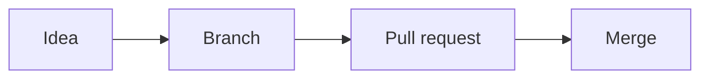

# Welcome to GitHub

You've probably heard "push it to GitHub" or "it's in the repo." This chapter explains what those words mean and why GitHub is worth learning, even if you never plan to call yourself a programmer.

:::summary In this chapter
- The difference between Git and GitHub
- What "version control" means, with an everyday example
- Why GitHub matters, especially when you work with AI
- The handful of words you'll hear constantly
- How this manual is organized, and the three ways to use GitHub
:::

## Git and GitHub are two different things

**Git** is a free program that runs on your computer. It watches a folder and records snapshots of the files in it over time, so you can see what changed, when, and why, and go back to any earlier version. Git was created in 2005 and is used almost everywhere.

**GitHub** is a website (github.com, owned by Microsoft) that stores copies of Git projects online. It adds everything you need to work with others: a web interface, discussions, task tracking, reviews, automation, and website hosting.

> [!NOTE]
> A good analogy: Git is like the "track changes" and version history in a word processor; GitHub is like a shared cloud drive built around that history.

There are other websites that host Git projects, such as GitLab and Bitbucket. The Git skills in this manual work with all of them. The GitHub-specific parts (pull requests, Actions, Pages, Copilot) are what make GitHub the most popular choice.

## What is version control?

**Version control** is a system that records changes to files over time so you can recall specific versions later. You already do a clumsy version of it if you have ever saved files like these:

```text
menu.docx
menu-v2.docx
menu-v2-FINAL.docx
menu-v2-FINAL-really-final.docx
```

Git replaces that mess with one file and a tidy list of saved moments. Each moment, called a **commit**, records exactly what changed, who changed it, when, and a short note explaining why. You can compare any two moments, or bring back any old version, at any time.

| Without version control | With Git |
|---|---|
| Many copies of the same file | One file, many saved versions |
| "Which one is the latest?" | The latest is always the current file |
| Changes overwrite each other | Changes are combined, or flagged for you |
| Undo only goes back a few steps | Undo goes back to the very first save |
| A crash can lose a day's work | Every commit is a recovery point |

## Why bother?

- **A safety net.** Every saved snapshot is permanent. Broke something? Go back.
- **A backup.** Your work lives on GitHub's servers as well as your computer.
- **A shared workspace.** Several people, or several AI agents, can work on the same project at once.
- **A portfolio.** Your public projects show what you can build.
- **AI tools expect it.** Claude Code, Copilot, Cursor, Lovable, Bolt, and others connect to GitHub to read, change, and publish your code.
- **It isn't only for code.** People use GitHub for writing books, keeping recipes, planning events, publishing websites, and storing research notes. Anything made of text files benefits from history.

## Words you'll hear constantly

| Word | Plain-English meaning |
|---|---|
| **Repository** (repo) | A project folder that Git tracks, plus its entire history |
| **Commit** | A saved snapshot of your files, with a message describing the change |
| **Branch** | A separate line of work, so you can try things without touching the main version |
| **Main** | The default branch: the "official" version of the project |
| **Merge** | Combine the changes from one branch into another |
| **Pull request** (PR) | A proposal to merge a branch, with a place to discuss and review it |
| **Issue** | A to-do item, bug report, or idea, tracked on GitHub |
| **Clone** | Download a full copy of a repository to your computer |
| **Push** / **Pull** | Send your commits up to GitHub / bring others' commits down |
| **Fork** | Your own copy of someone else's repository on GitHub |

Don't worry about memorizing these; each one gets its own explanation as we go, and they're all in the Glossary.

## Three ways to use GitHub

You can do almost everything in this manual in more than one way. Pick whichever feels comfortable, and switch any time.

| Way | What it looks like | Best for |
|---|---|---|
| **The website** | Clicking buttons on github.com | Small edits, planning, reviewing |
| **An app** | GitHub Desktop, or your code editor's Git panel | Beginners who want to see changes visually |
| **The command line** | Typing `git` and `gh` commands in a terminal | Speed, and working alongside AI agents |

A fourth way is increasingly common: you describe what you want in plain English, and an **AI agent** (a program that can take actions, not just chat) runs the commands for you. Even then, knowing what the commands do lets you check the agent's work.

## How this manual is organized

:::cols
- **Getting started:** account, website tour, first repository, Markdown, project files
- **Git on your computer:** installing, fundamentals, the daily loop
- **Working in parallel:** branches, merging, rebasing, undoing mistakes
- **Working together:** pull requests, open source, issues, projects
- **Tools:** GitHub Desktop and the `gh` command line
- **Automation and publishing:** Actions, secrets, Pages, releases
- **Cloud and AI:** Codespaces, Copilot, Claude Code
- **Staying safe:** account and repository security
- **Teams and mobile:** organizations, GitHub Mobile, pricing
- **Help:** troubleshooting, quick reference, glossary
:::

> [!TIP]
> You don't need to read in order. If you only want to publish a website, read the first four chapters and then jump to GitHub Pages. If something breaks, the Undoing Mistakes and Troubleshooting chapters are written for exactly that moment.

:::checklist
- I can explain the difference between Git and GitHub
- I know what a commit, branch, and pull request are, roughly
- I've picked the way I'd like to start: website, app, or command line
:::
# Create Your Account

Everything on GitHub starts with a free **personal account**: your identity on the site. This chapter gets you signed up, secured, and looking friendly, in about fifteen minutes.

:::summary In this chapter
- Signing up and choosing a good username
- Keeping your email address private
- Turning on two-factor authentication
- Making your profile and profile README
- Taming notifications
:::

## Sign up

:::steps Create a free GitHub account
1. **Go to github.com.** Click **Sign up**.
2. **Enter your email, a password, and a username.** Your username becomes part of your web address (github.com/*username*), so pick something you're happy to share professionally.
3. **Verify.** Solve the quick puzzle and enter the code GitHub emails you.
4. **Choose the Free plan.** It includes unlimited public and private repositories. You can upgrade later.
:::

> [!TIP]
> Choose a username that's short and easy to say aloud. Changing it later breaks old links to your work.

### Public or private: what the plan gives you

A **public** repository can be seen by anyone on the internet (only people you invite can change it). A **private** repository is visible only to you and the people you invite. The Free plan lets you create as many of each as you like, with unlimited collaborators. The paid plans, covered in the Plans and Pricing chapter, mostly add extra features for private repositories and teams.

## Keep your email address private

Every commit you make is stamped with an email address, and on public projects anyone can read it. GitHub gives you a private stand-in address so your real one stays hidden.

:::steps Hide your email
1. **Open your email settings.** Click your profile picture (top right), then **Settings**, then **Emails** in the sidebar.
2. **Tick "Keep my email addresses private."** GitHub shows your **noreply** address, which looks like `12345+username@users.noreply.github.com`.
3. **Tick "Block command line pushes that expose my email."** Git will then refuse to publish commits that contain your real address by mistake.
4. **Copy the noreply address.** You'll give it to Git in the Install Git chapter.
:::

## Turn on two-factor authentication

**Two-factor authentication** (2FA) means signing in needs your password *plus* a second proof, such as a code from your phone. GitHub requires 2FA for anyone who contributes code, so set it up now.

:::steps Enable 2FA
1. **Open settings.** Click your profile picture (top right), then **Settings**.
2. **Find the security page.** Go to [[Password and authentication]].
3. **Enable two-factor authentication.** Click **Enable two-factor authentication**.
4. **Scan the QR code** with an authenticator app such as Google Authenticator, Microsoft Authenticator, 1Password, or Authy, and type the 6-digit code it shows.
5. **Save your recovery codes.** Download them and keep them somewhere safe, offline. They're your only way back in if you lose your phone.
6. **Add a passkey (optional, recommended).** A **passkey** lets you sign in with your fingerprint, face, or device PIN instead of typing a password.
:::

> [!CAUTION]
> Lose your phone *and* your recovery codes, and GitHub support usually cannot restore your account. Print the recovery codes and store them with your important papers.

After you set up 2FA, GitHub runs a 28-day **check-up**: at some point in those four weeks it asks you to prove you can still produce a code. That catches a badly configured app before it locks you out. The Securing Your Account chapter covers every 2FA method, passkeys, and backups in depth.

## Make your profile friendly

Click your profile picture, then **Your profile**, then **Edit profile** to add a photo, a short bio, your location, and links. Pinning your best repositories (the **Customize your pins** link on your profile) puts them front and center.

### A profile README

A **profile README** is a special page that appears at the top of your profile. It's a great place to say who you are and what you're working on.

:::steps Create a profile README
1. **Create a new repository** named exactly the same as your username. GitHub shows a friendly message when the name matches.
2. **Make it Public.** Profile READMEs only show for public repositories.
3. **Tick "Add a README file"** and click **Create repository**.
4. **Edit README.md.** Write a few lines about yourself (the Markdown chapter shows how to format it) and commit.
5. **Visit your profile.** The README now appears above your repositories.
:::

```markdown title=README.md
# Hi, I'm Sam

I run a small bakery and I'm learning to build our website.

- Currently learning: GitHub and HTML
- Reach me at: sam@example.com
```

## Tame your notifications

GitHub tells you when someone mentions you, asks for your review, or replies to something you're involved in. You choose whether those arrive by email, on the website, or on your phone.

| Setting | Where | Tip |
|---|---|---|
| Delivery (email, web, mobile) | [[Settings > Notifications]] | Start with web and mobile; email gets noisy |
| Which repositories you follow | **Watch** button on a repository | "Participating and @mentions" is calm |
| Your inbox | Bell icon, top right | Mark items **Done** to clear them |

> [!TIP]
> When you're added to a busy project, GitHub may automatically watch it for you. If your inbox fills up, open the repository, click **Watch**, and switch to **Participating and @mentions**.

:::checklist
- Account created on the Free plan
- Email kept private, noreply address copied
- 2FA on, recovery codes printed or saved offline
- Profile photo and bio added
- Notifications set the way I like
:::
# A Tour of the GitHub Website

Before you create anything, it helps to know your way around. This chapter is a guided walk through the screens you'll use most, so nothing looks unfamiliar later.

:::summary In this chapter
- The top bar and your dashboard
- The anatomy of a repository page
- What each repository tab is for
- Stars, watching, and forks
- Searching GitHub, and keyboard shortcuts that save time
:::

## The top bar

The strip across the top of every page is your control panel.

| Item | What it does |
|---|---|
| **GitHub logo** (left) | Takes you home to your dashboard |
| **Search box** | Finds repositories, code, issues, and people |
| **+ menu** | Create a new repository, issue, gist, or organization |
| **Copilot icon** | Opens Copilot Chat, if you use Copilot |
| **Bell / inbox icon** | Your notifications |
| **Profile picture** | Your profile, repositories, stars, settings, and sign out |

## Your dashboard

When you're signed in, github.com shows your **dashboard**: a feed of recent activity from people and projects you follow, plus a list of your repositories on the left. Use the left list as a quick launcher for projects you visit often.

## Anatomy of a repository page

A **repository page** (github.com/*owner*/*name*) is where you'll spend most of your time. From top to bottom:

1. **The name line.** The owner and repository name, a Public or Private label, and the **Watch**, **Fork**, and **Star** buttons.
2. **The tabs.** Code, Issues, Pull requests, Actions, and more (see the next table).
3. **The branch menu.** Shows which branch you're looking at, usually `main`. Click it to switch branches or create one.
4. **The green Code button.** Copy the address for cloning, open a codespace, or download a ZIP.
5. **The latest commit line.** Who changed something last, the message, and a link to the full history (the clock icon with the number of commits).
6. **The file list.** Folders and files. Click any name to open it.
7. **The README.** The project's welcome page, shown below the files.
8. **The About sidebar** (right). A description, website link, topics, license, and links to **Releases** and **Packages**.

### What the tabs are for

| Tab | Use it to |
|---|---|
| **Code** | Browse files, branches, and history |
| **Issues** | Track bugs, tasks, and ideas |
| **Pull requests** | Propose, review, and merge changes |
| **Actions** | See automations run, and read their logs |
| **Projects** | Plan work on boards and tables |
| **Wiki** | Longer documentation pages (if turned on) |
| **Security and quality** | Vulnerability alerts and scanning results |
| **Insights** | Graphs of activity, contributors, and traffic |
| **Settings** | Repository options (only if you're an admin) |

> [!NOTE]
> On narrow windows, some tabs hide behind a **…** menu at the end of the tab row. If you can't find a tab, look there first.

## Stars, watching, and forks

- **Star** is a bookmark and a thank-you. Starred repositories are listed under your profile's **Stars** tab, and star counts show how popular a project is.
- **Watch** controls notifications for that repository: everything, only what involves you, or nothing.
- **Fork** makes your own copy of the repository under your account, which you can change freely. The Forking and Open Source chapter explains when and why.

## Finding things

### The search box

Type words into the search box and press <kbd>Enter</kbd>, then use the filters on the left (Code, Repositories, Issues, Pull requests, Users) to narrow the results. You can also type **qualifiers** (little filters written as `name:value`) straight into the box:

| Type this | To find |
|---|---|
| `user:octocat` | Everything owned by that account |
| `repo:owner/name bug` | The word "bug" in one repository |
| `language:python stars:>100` | Popular Python projects |
| `is:issue is:open label:"good first issue"` | Beginner-friendly open issues |
| `is:pr author:@me` | Pull requests you opened |

### Exploring

Visit **github.com/explore** for recommended projects and topics, and **github.com/trending** for repositories getting lots of stars this week. Both are good ways to see how other people structure their projects.

## Keyboard shortcuts

Press <kbd>?</kbd> on any GitHub page to see the shortcuts available there. The most useful ones:

:::compact
| Keys | Action |
|---|---|
| <kbd>S</kbd> or <kbd>/</kbd> | Jump to the search box |
| <kbd>.</kbd> | Open the repository in the github.dev editor |
| <kbd>T</kbd> | File finder: type part of a file name |
| <kbd>L</kbd> | Jump to a line number in a file |
| <kbd>B</kbd> | Show blame (who last changed each line) |
| <kbd>Y</kbd> | Turn the address into a permanent link to this exact version |
| <kbd>G</kbd> then <kbd>C</kbd> | Go to the Code tab |
| <kbd>G</kbd> then <kbd>I</kbd> | Go to Issues |
| <kbd>G</kbd> then <kbd>P</kbd> | Go to Pull requests |
| <kbd>G</kbd> then <kbd>A</kbd> | Go to Actions |
| <kbd>G</kbd> then <kbd>N</kbd> | Go to your notifications |
:::

> [!TIP]
> Shortcuts only work when your cursor isn't inside a text box. Click on an empty part of the page first.

:::checklist
- I can find the + menu, notifications, and Settings
- I know what the Code, Issues, Pull requests, and Actions tabs are for
- I've starred one interesting project
- I've tried <kbd>?</kbd> and <kbd>T</kbd> on a repository
:::
# Your First Repository, Entirely in the Browser

You can do real work on GitHub without installing anything. Let's create a repository, edit a file, add folders, and save commits, all from the website.

:::summary In this chapter
- Creating a repository
- Editing, creating, uploading, renaming, and deleting files
- Making commits from the browser
- Reading the history of a file
- Renaming, changing visibility of, or deleting a repository
:::

## Create a repository

:::steps New repository
1. **Click the + menu** (top right) and choose **New repository**.
2. **Name it.** For example `my-first-repo`. Use lowercase letters and dashes.
3. **Add a description**, like "Learning GitHub."
4. **Choose Public or Private.** Public means anyone can see it; private means only you and people you invite.
5. **Tick "Add a README file."** A README is the welcome page of your repository.
6. **Click Create repository.**
:::

You're now looking at your repository's home page. The file list is in the middle, the README is shown below it, and tabs across the top lead to **Issues**, **Pull requests**, **Actions**, and **Settings**.

> [!NOTE]
> The create page also offers a `.gitignore` template and a license. Both are explained in the README, LICENSE and .gitignore chapter. It's fine to skip them for a practice repository.

## Edit a file and make your first commit

:::steps Edit and commit
1. **Open README.md** by clicking its name.
2. **Click the pencil icon** (Edit this file).
3. **Change the text.** Add a line such as `This is where I'm learning GitHub!`
4. **Check the Preview tab** to see how it will look.
5. **Click Commit changes…** (top right).
6. **Write a commit message**, a short note saying what you did: `Add welcome line to README`.
7. **Choose "Commit directly to the main branch"** and click **Commit changes**.
:::

Congratulations: that's a **commit**. Click the clock icon labeled **commits** on the repository page to see the history, including GitHub's original "Initial commit."

> [!TIP]
> The commit dialog also offers **Create a new branch for this commit and start a pull request**. That's the safer choice on shared projects, and the Pull Requests chapter explains why.

## Create new files and folders

:::steps Create a file
1. **Click Add file**, then **Create new file**.
2. **Type a name**, such as `notes.md`.
3. **To put it in a folder, type a slash.** Typing `ideas/notes.md` creates a folder called `ideas` with the file inside. Git only stores folders that contain at least one file.
4. **Write some text**, then **Commit changes…** as before.
:::

## Upload files

On the repository page, click **Add file**, then **Upload files**, and drag in documents, images, or code. Write a commit message and click **Commit changes**.

| Limit | Size |
|---|---|
| Largest file you can upload through the browser | 25 MiB |
| Git warns you about files larger than | 50 MiB |
| GitHub blocks files larger than | 100 MiB |
| Recommended total repository size | Under 1 GB (under 5 GB strongly recommended) |

For big files such as videos or design files, use **Git Large File Storage** (Git LFS), an add-on that stores large files separately, or keep them out of the repository altogether.

## Rename, move, or delete a file

- **Rename or move:** open the file, click the pencil, and edit the name box at the top. Add `folder/` in front to move it into a folder, then commit.
- **Delete:** open the file, click the **…** menu (top right of the file), choose **Delete file**, and commit.

Nothing is truly lost: deleted files remain in the history, and you can bring them back.

## Read the history of a file

Open any file and click **History** to see every commit that changed it. Click a commit to see a **diff**: a before-and-after view where removed lines are red with a minus sign and added lines are green with a plus sign.

Click **Blame** (or press <kbd>B</kbd>) to see, line by line, which commit last changed each line and who made it. Despite the name, it's for understanding, not blaming!

## Repository settings you'll want early

All of these live under the repository's **Settings** tab, on the **General** page.

| Task | Where |
|---|---|
| Rename the repository | Repository name box at the top |
| Turn features on or off (Wiki, Issues, Discussions) | **Features** section |
| Make it public or private | **Danger Zone**, then **Change visibility** |
| Make it read-only but keep it | **Danger Zone**, then **Archive this repository** |
| Delete it forever | **Danger Zone**, then **Delete this repository** |

> [!WARNING]
> Deleting a repository removes its issues, pull requests, and history for everyone. If you just want it out of the way, **archive** it instead.

> [!TIP]
> Press the <kbd>.</kbd> (period) key on any repository page to open **github.dev**, a full code editor that runs in your browser. It's great for editing several files at once. The Codespaces chapter covers it.

:::checklist
- Created `my-first-repo` with a README
- Made a commit by editing a file
- Created a file inside a new folder
- Looked at a diff in the History view
- Found the Danger Zone (and didn't press anything)
:::
# Writing in Markdown

README files, issues, pull requests, comments, and wikis on GitHub all use **Markdown**, a simple way to format text with ordinary symbols. You type plain characters, and GitHub turns them into headings, bold text, lists, and links. Learning it takes about twenty minutes and pays off everywhere, including in AI chat tools, which use the same symbols.

:::summary In this chapter
- Headings, emphasis, lists, and links
- Images, tables, and code blocks
- GitHub extras: task lists, mentions, issue links, alerts, and collapsible sections
- A ready-to-use README skeleton you'll fill in later
:::

## The basics

```markdown
# Big heading
## Smaller heading
### Even smaller

**bold**, *italic*, ~~strikethrough~~, and `code`

- a bullet
- another bullet
  - an indented bullet (two spaces in)

1. a numbered step
2. another step

[a link](https://github.com)

> A quotation, shown with a bar down the side.
```

> [!TIP]
> In any GitHub text box you can select text and press <kbd>Ctrl</kbd> + <kbd>B</kbd> (<kbd>Cmd</kbd> + <kbd>B</kbd> on a Mac) for bold, or <kbd>Ctrl</kbd> + <kbd>I</kbd> for italic. Pasting a web address over selected text turns it into a link.

### Line breaks and paragraphs

Leave a blank line between paragraphs. A single line break inside a paragraph is usually joined up with the line before. To force a new line without a gap, end the line with a backslash `\` or two spaces.

## Images

```markdown

```

The text in square brackets is the **alt text**: a description read aloud by screen readers and shown if the image can't load. Always write one. In an issue or comment you can simply drag an image into the text box and GitHub uploads it and writes the Markdown for you.

## Tables

```markdown
| Day      | Opens | Closes |
|----------|-------|--------|
| Monday   | 8am   | 4pm    |
| Saturday | 9am   | 2pm    |
```

The second line, made of dashes, separates the header from the rows. The columns don't have to line up perfectly; neat spacing just makes the plain text easier to read.

## Code blocks

Wrap code in three backticks, and name the language after the first three for colored highlighting:

````markdown
```python
print("Hello, GitHub!")
```
````

## GitHub extras

GitHub adds a few features to standard Markdown, sometimes called **GitHub Flavored Markdown**.

| Write | You get |
|---|---|
| `- [ ] Buy flour` | A tick-box task list item |
| `- [x] Order boxes` | A ticked item |
| `@username` | A mention that notifies that person |
| `#12` | A link to issue or pull request number 12 |
| `:tada:` | An emoji (type `:` to see suggestions) |
| A bare web address | A clickable link |

### Alerts

Alerts are colored callout boxes, like the tips in this manual. Start a quote with one of five keywords:

```markdown
> [!NOTE]
> Useful background information.

> [!TIP]
> A helpful shortcut.

> [!IMPORTANT]
> Something people must know.

> [!WARNING]
> Something that needs care.

> [!CAUTION]
> A risky action to avoid.
```

### Collapsible sections and footnotes

```markdown
<details>
<summary>Click to see the full error log</summary>

The long text goes here, hidden until someone clicks.

</details>

Our hours change in winter.[^1]

[^1]: From November to February we close at 3pm.
```

### Diagrams

GitHub can draw simple flowcharts from text using **Mermaid**, a diagram language. Put the description in a code block labeled `mermaid`:

````markdown

````

## A README skeleton

Copy this into any new project's `README.md` and fill in the blanks. The next chapter explains what makes a README genuinely helpful.

```markdown title=README.md
# Project name

One sentence: what this is and who it's for.

## What it does

- Main feature one
- Main feature two

## How to use it

1. Step one
2. Step two

## Contributing

Ideas and fixes are welcome. Please open an issue first.

## License

MIT. See the LICENSE file.
```

```prompt
Turn these notes into a clear, friendly README.md for my GitHub
repository. Use headings for What it does, How to install,
How to use, and License. Keep it short and use plain English.
Notes: [paste your notes here]
```

:::checklist
- I can make headings, bold text, lists, and links
- I've added an image with alt text
- I've written a task list in an issue or README
- I've tried an alert box such as `> [!TIP]`
:::
# README, LICENSE and .gitignore

Three small files make the difference between a folder of code and a project people can understand, use, and trust. This chapter shows how to write a good README, how to choose a license in plain English, and how to keep junk and secrets out of your repository with `.gitignore`.

:::summary In this chapter
- What makes a README genuinely useful
- Choosing a license: MIT, Apache 2.0, GPL, or none
- Writing and testing a `.gitignore`
- The other "community health" files: CONTRIBUTING, CODE_OF_CONDUCT, SECURITY
:::

## The README: your project's front door

GitHub shows `README.md` below the file list, so it's the first thing visitors read. A good README answers five questions, in this order:

1. **What is this?** One or two sentences, in plain English.
2. **Why would I want it?** The problem it solves.
3. **How do I get it running?** Install steps a newcomer can copy.
4. **How do I use it?** One short example, ideally with a screenshot.
5. **How can I help, and under what license?** Links to CONTRIBUTING and LICENSE.

> [!TIP]
> Write the README for a smart friend who has never seen your project. If they would need to message you to get started, the README is missing a step.

### README checklist

:::checklist
- A title and a one-line description
- A screenshot or short example near the top
- Install and run steps, tested on a fresh computer
- Where to report problems (usually the Issues tab)
- The license name, linking to the LICENSE file
:::

## Choosing a license

A **license** is a short legal text that tells others what they may do with your work. Without one, the default copyright laws apply: you keep all rights, and nobody may legally copy, change, or share your code, even if the repository is public. So if you want people to use your work, add a license.

GitHub runs **choosealicense.com** to help you pick. Most projects use one of these:

| License | In one sentence | Choose it if |
|---|---|---|
| **MIT** | Do anything, just keep the copyright notice | You want maximum use with minimum fuss |
| **Apache 2.0** | Like MIT, plus explicit patent permission | Companies may use it and patents matter |
| **GPL-3.0** | Share changes under the same license | You want improvements to stay open |
| **No license** | All rights reserved | You only want people to look, not reuse |

> [!NOTE]
> This is a plain-English summary, not legal advice. For anything commercial or important, read the full text at choosealicense.com or ask a lawyer.

:::steps Add a license on GitHub
1. **Click Add file**, then **Create new file**.
2. **Type `LICENSE`** (all capitals) as the file name.
3. **Click Choose a license template**, which appears once you type the name.
4. **Pick a license** from the list on the left, check the year and name, and click **Review and submit**.
5. **Commit the file.** GitHub now shows the license in the About sidebar.
:::

## .gitignore: keeping files out

Some files should never go into a repository: passwords, huge downloads, and temporary files. List them in a file named `.gitignore` at the top of your project, and Git pretends they don't exist.

```text title=.gitignore
# secrets
.env
# dependencies (re-downloadable)
node_modules/
# system junk
.DS_Store
```

GitHub offers ready-made `.gitignore` templates when you create a repository; pick the one for your language or tool.

### Pattern rules

| Pattern | Matches |
|---|---|
| `notes.txt` | Any file named `notes.txt`, in any folder |
| `/notes.txt` | Only `notes.txt` at the top level |
| `build/` | Any folder named `build`, and everything inside |
| `*.log` | Every file ending in `.log` |
| `!keep.log` | An exception: do track `keep.log` |
| `# comment` | A note for humans; ignored by Git |

### When .gitignore "doesn't work"

`.gitignore` only affects files Git isn't tracking yet. If you already committed a file, adding it to `.gitignore` won't remove it. Tell Git to stop tracking it (the file stays on your computer):

```bash
git rm --cached .env
git commit -m "Stop tracking .env"
```

To find out which rule is ignoring a file, ask Git directly:

```bash
git check-ignore -v path/to/file
```

> [!CAUTION]
> If the file you committed contained a password or key, removing it is not enough: it's still in the history. Change the password or revoke the key first. See the Securing Your Repositories chapter.

### A personal ignore list

Files your own computer creates, like `.DS_Store` on a Mac or editor settings folders, can go in a global ignore file so you don't have to add them to every project:

```bash
git config --global core.excludesFile ~/.gitignore_global
```

Then list the patterns in `~/.gitignore_global` (the `~` means your home folder).

## Community health files

GitHub recognizes a few more files and links to them automatically when people open issues or pull requests. Put them at the top level, in a `docs` folder, or in a `.github` folder.

| File | What it says |
|---|---|
| `CONTRIBUTING.md` | How to suggest changes, and what you expect from contributors |
| `CODE_OF_CONDUCT.md` | How people should treat each other in the project |
| `SECURITY.md` | How to report a security problem privately |
| `SUPPORT.md` | Where to get help |
| `FUNDING.yml` | Shows a **Sponsor** button (in the `.github` folder) |

On a public repository, open **Insights**, then **Community standards**, to see a checklist of which of these you have, with buttons to add the missing ones from templates.

```prompt
Write a short, friendly CONTRIBUTING.md for my small open source
project. Explain how to report a bug, how to suggest a feature,
and how to open a pull request. Ask contributors to open an issue
before starting big changes. Keep it under 300 words.
```

:::checklist
- README answers what, why, install, use, and license
- A LICENSE file chosen on purpose (or deliberately none)
- `.gitignore` covers secrets, dependencies, and junk; CONTRIBUTING and SECURITY added to public projects
:::
# Install Git on Your Computer

Working in the browser is great for small edits. For real projects, and for AI coding tools that work on your computer, you'll want Git installed locally. You can drive it three ways: a friendly app (**GitHub Desktop**), the **command line**, or let an **AI agent** run the commands for you.

:::summary In this chapter
- A two-minute introduction to the terminal
- Installing Git on Windows, macOS, or Linux
- Telling Git who you are, and a few settings worth changing
- Signing in to GitHub from your computer
- Choosing between GitHub Desktop and the command line
:::

## A two-minute terminal primer

A **terminal** (also called the command line or shell) is a window where you type instructions instead of clicking. On Windows use **Git Bash** (installed with Git) or **Terminal**; on a Mac, open **Terminal** from Applications, then Utilities; on Linux, open your Terminal app.

The terminal is always "standing in" one folder, called the **current directory**. These commands move you around:

| Command | What it does |
|---|---|
| `pwd` | Print where you are now |
| `ls` | List the files here (`dir` in Windows Command Prompt) |
| `cd projects` | Move into the `projects` folder |
| `cd ..` | Move up one folder |
| `mkdir my-site` | Make a new folder called `my-site` |
| `clear` | Tidy the screen |

> [!TIP]
> Press <kbd>Tab</kbd> to auto-complete file and folder names, and the up arrow to bring back your previous command. Press <kbd>Ctrl</kbd> + <kbd>C</kbd> to stop a command that's running.

## Install Git

| System | How |
|---|---|
| **Windows** | Download the installer from git-scm.com and accept the defaults. It includes **Git Bash** and **Git Credential Manager**, which handles signing in to GitHub. |
| **macOS** | Open Terminal and type `git --version`. If Git isn't installed, macOS offers to install the developer tools. Or use Homebrew: `brew install git`. |
| **Linux** | Ubuntu/Debian: `sudo apt install git` · Fedora: `sudo dnf install git` |

Check it worked:

```bash
git --version
```

You should see something like `git version 2.x`. Any recent version is fine.

## Tell Git who you are

Every commit is labeled with a name and email. Set them once:

```bash
git config --global user.name "Your Name"
git config --global user.email "you@example.com"
git config --global init.defaultBranch main
```

> [!TIP]
> To keep your real email private, use the **noreply** address GitHub gives you. Find it at [[Settings > Emails]] (it looks like `12345+username@users.noreply.github.com`) and tick **Keep my email addresses private**.

The `--global` part means "for every project on this computer." Leave it out inside a project folder to use different details just for that project, for example a work email.

### A few settings worth changing

```bash
# use VS Code for commit messages instead of the Vim editor
git config --global core.editor "code --wait"

# when pulling, merge (the beginner-friendly default)
git config --global pull.rebase false

# see all your settings
git config --list
```

> [!NOTE]
> If Git ever drops you into a strange full-screen editor called **Vim**, type <kbd>Esc</kbd>, then `:wq`, then <kbd>Enter</kbd> to save and exit. Setting `core.editor` as above stops it happening.

### Line endings on Windows

Windows and Mac/Linux mark the end of a line with different invisible characters. The Git for Windows installer's default handles this for you. If teammates see every line of a file marked as changed, run this on Windows:

```bash
git config --global core.autocrlf true
```

## Sign in to GitHub from your computer

GitHub stopped accepting your account password for Git operations years ago. You sign in through the browser instead, with one of these:

| Method | How | Good for |
|---|---|---|
| **GitHub Desktop** | Sign in when the app starts | App users |
| **GitHub CLI** | `gh auth login` | Command line and AI agents |
| **Git Credential Manager** | Pops up a browser window on first push | Windows users |
| **SSH key** | A key file on your computer | Long-term setups |

The Securing Your Account chapter explains SSH keys and personal access tokens.

## Option A: GitHub Desktop (easiest)

Download **GitHub Desktop** from desktop.github.com (Windows 10 64-bit or later, and macOS 12 or later). Sign in with your GitHub account, and it handles authentication for you. Every action in the next chapters has a button in Desktop: **Clone**, **Commit**, **Push origin**, **Fetch**, **Create branch**, **Create pull request**. The GitHub Desktop chapter walks through it.

## Option B: the GitHub CLI (best for AI tools)

The **GitHub CLI**, a program called `gh`, lets you, and AI agents like Claude Code, do GitHub things from the terminal: create repositories, open pull requests, manage issues.

| System | Install command |
|---|---|
| macOS | `brew install gh` |
| Windows | `winget install --id GitHub.cli` (or the installer from cli.github.com) |
| Linux | Follow the apt/dnf instructions linked from cli.github.com |

Then sign in. It also sets up Git to use your GitHub login:

```bash
gh auth login
```

Answer the questions: choose **GitHub.com**, **HTTPS**, **Yes** to authenticate Git, and **Login with a web browser**. Copy the one-time code, paste it into the browser page that opens, and approve. Check it worked with:

```bash
gh auth status
```

The gh CLI Cookbook chapter is full of ready-to-use commands.

## Option C: let an AI agent drive

If you use Claude Code, Copilot, or a similar agent, you can simply ask: "Initialize Git in this folder, make a first commit, and publish it as a private GitHub repository." It will run the same commands you'll learn next. Read what it's about to do before approving, especially anything with `--force` or `reset --hard`.

:::checklist
- `git --version` prints a version
- Name and (noreply) email set with `git config --global`
- Default branch set to `main`
- Signed in with GitHub Desktop or `gh auth login`
:::
# Git Fundamentals in Depth

You can use Git for months by memorizing four commands. But a little understanding of what Git is actually doing makes everything else in this manual click, and makes mistakes far less scary. This chapter explains commits, staging, diffs, and history properly, with real examples you can try.

:::summary In this chapter
- What a commit really is, and how Git names it
- The three places your work lives, and the life cycle of a file
- Staging exactly what you want, even part of a file
- Reading `git status` and `git diff` output
- Exploring history with `git log`, `git show`, and `git blame`
- Pointing at commits with `HEAD`, `HEAD~1`, and friends
:::

## Snapshots, not copies of changes

Each **commit** is a complete snapshot of every tracked file at one moment, stored efficiently so unchanged files take no extra space. Every commit records:

| Part | Example | Meaning |
|---|---|---|
| **Hash** | `3f9a2c1…` | A unique ID made from the contents |
| **Author** | Sam Lee | Who made it, and their email |
| **Date** | 16 Oct 2026, 10:42 | When it was made |
| **Message** | `Add opening hours` | Why it was made |
| **Parent** | `a71b0e4…` | The commit that came just before |

The **hash** is a 40-character code such as `3f9a2c1e8b…`. You almost never need all of it: the first seven characters (the **short hash**, like `3f9a2c1`) are enough to identify a commit in nearly every project.

Because each commit points to its parent, the history forms a chain:

```text
First  <--  Add menu  <--  Fix prices  <--  Add hours   (main)
```

A **branch** is simply a label pointing at the newest commit in a chain. More on that in the Branches chapter.

## The three places your work lives

| Place | What it is |
|---|---|
| **Working folder** | The files you see and edit on your computer |
| **Staging area** | Changes you've marked as "ready to go in the next commit" (also called the **index**) |
| **Repository** | The saved history of commits, both on your computer (*local*) and on GitHub (the *remote*, usually named `origin`) |

Think of packing a parcel. The working folder is your desk, covered in things. The staging area is the open box: you choose what goes in. A commit seals the box and labels it. Pushing posts it to GitHub.

### The life cycle of a file

| State | Meaning | Gets there by |
|---|---|---|
| **Untracked** | New; Git has never saved it | Creating a file |
| **Modified** | Changed since the last commit | Editing a tracked file |
| **Staged** | Marked for the next commit | `git add` |
| **Committed** | Safely stored in history | `git commit` |

## Reading git status

`git status` is the command you'll run most. It never changes anything, so run it whenever you're unsure. Here's real output, with one edited file and one new file:

```text
On branch main
Changes not staged for commit:
  (use "git add <file>..." to update what will be committed)
  (use "git restore <file>..." to discard changes in working directory)
	modified:   menu.txt

Untracked files:
  (use "git add <file>..." to include in what will be committed)
	hours.txt

no changes added to commit (use "git add" and/or "git commit -a")
```

Notice that Git tells you the next command to use in brackets. For a compact version, run `git status --short`: `M` means modified, `??` means untracked, and a letter in the first column means staged.

## Staging exactly what you want

| Command | Stages |
|---|---|
| `git add menu.txt` | One file |
| `git add images/` | Everything in a folder |
| `git add .` | Everything changed in the current folder and below |
| `git add -p` | Pieces of files, one chunk at a time |
| `git restore --staged menu.txt` | Un-stages a file (your edits stay) |

### Staging part of a file

Say you fixed a typo *and* started a new feature in the same file. `git add -p` (p for "patch") shows each changed chunk and asks what to do:

| Answer | Means |
|---|---|
| `y` | Yes, stage this chunk |
| `n` | No, skip it |
| `s` | Split it into smaller chunks |
| `q` | Quit; keep what you've chosen so far |
| `?` | Show help |

Now you can commit the typo fix on its own, with its own clear message. Small, focused commits make history easy to read and easy to undo.

## Committing

```bash
git commit -m "Fix typo in opening hours"
```

For a longer explanation, add a second `-m`: the first becomes the title and the second the body.

```bash
git commit -m "Add winter hours" -m "We close at 3pm from Nov to Feb."
```

`git commit -am "message"` stages every *modified tracked* file and commits in one step. It skips brand-new files, so use it only when you know there are none.

## Reading a diff

A **diff** shows the difference between two versions. `git diff` shows unstaged changes; `git diff --staged` shows what's about to be committed.

```text
diff --git a/menu.txt b/menu.txt
--- a/menu.txt
+++ b/menu.txt
@@ -1,2 +1,3 @@
 Croissant  3.00
-Muffin     2.50
+Muffin     2.75
+Scone      2.25
```

- Lines starting with `-` were removed; lines with `+` were added. A changed line shows as one of each.
- Lines with a space in front are unchanged context, shown so you can find your place.
- The `@@ -1,2 +1,3 @@` line says where the chunk is: starting at line 1, two lines before and three lines after.

| Command | Compares |
|---|---|
| `git diff` | Working folder vs staging area |
| `git diff --staged` | Staging area vs last commit |
| `git diff HEAD` | Everything since the last commit |
| `git diff main..my-branch` | Two branches |
| `git diff --stat` | Just a summary of files and line counts |

## Exploring history

:::compact
| Command | What it shows |
|---|---|
| `git log` | Full list of commits, newest first (press <kbd>q</kbd> to exit) |
| `git log --oneline` | One commit per line: short hash and title |
| `git log --oneline --graph --all` | A text drawing of all branches |
| `git log -n 5` | Only the last five commits |
| `git log -p menu.txt` | Every change ever made to one file |
| `git log --author="Sam"` | Commits by one person |
| `git log --since="2 weeks ago"` | Recent commits only |
| `git log --grep="hours"` | Commits whose message mentions "hours" |
| `git show 3f9a2c1` | One commit's message and diff |
| `git blame menu.txt` | Who last changed each line, and in which commit |
:::

## Pointing at commits

You can name a commit in several ways, and use these names in almost any command:

| Name | Means |
|---|---|
| `3f9a2c1` | A specific commit, by short hash |
| `HEAD` | Where you are now (usually the newest commit on your branch) |
| `HEAD~1` | One commit before `HEAD` |
| `HEAD~3` | Three commits before `HEAD` |
| `main` | The newest commit on the `main` branch |
| `v1.0.0` | A tagged commit (see the Releases chapter) |

### Looking at an old version

```bash
# print a file as it was three commits ago
git show HEAD~3:menu.txt

# bring back that old version into your working folder
git restore --source=HEAD~3 menu.txt
```

You can also step back in time with the whole project:

```bash
git switch --detach HEAD~3
```

Git calls this **detached HEAD**: you're looking at an old commit rather than standing on a branch. Look around freely. To return, run `git switch main`. If you want to keep changes made there, create a branch first with `git switch -c rescue-branch`.

> [!TIP]
> Git refuses to switch if you have uncommitted changes that would be overwritten. Commit them, or set them aside with `git stash` (explained in the Undoing Mistakes chapter), then switch.

## Try it: a five-minute practice session

:::steps Practice in a scratch folder
1. **Make a folder and start a repository.**
   ```bash
   mkdir git-practice && cd git-practice
   git init
   ```
2. **Create a file and commit it.**
   ```bash
   echo "Croissant 3.00" > menu.txt
   git add menu.txt
   git commit -m "Start the menu"
   ```
3. **Change it twice, and look before you commit.**
   ```bash
   echo "Muffin 2.50" >> menu.txt
   git status
   git diff
   git commit -am "Add muffins"
   ```
4. **Read the history.**
   ```bash
   git log --oneline
   git show HEAD~1:menu.txt
   ```
:::

:::checklist
- I can explain working folder, staging area, and repository
- I read `git status` before every commit
- I can stage one file, or part of a file
- I can read a diff and find a file's history
- I know what `HEAD~1` means
:::
# The Everyday Workflow

Almost all Git work is the same loop: **change files → stage → commit → push**. Here it is with the command line; GitHub Desktop has a button for each step, covered in its own chapter.

:::summary In this chapter
- Getting a repository onto your computer, or publishing one you already have
- Remotes: how your computer and GitHub talk to each other
- The daily loop, and fetch versus pull
- Writing commit messages people will thank you for
- A day in the life, start to finish
:::

## Get a repository onto your computer

:::steps Clone a repository
1. **Copy the address.** On the repository page, click the green **Code** button and copy the HTTPS URL.
2. **Open a terminal** in the folder where you keep projects.
3. **Clone it.**
   ```bash
   git clone https://github.com/your-username/my-first-repo.git
   cd my-first-repo
   ```
:::

Or, with the GitHub CLI: `gh repo clone your-username/my-first-repo`.

**Cloning** downloads every file *and* the full history, and remembers where it came from, so `git push` and `git pull` know where to go.

### Publishing a folder you already have

Starting from a folder you already have instead? Turn it into a repository and publish it in one go:

```bash
cd my-project
git init
git add .
git commit -m "First commit"
gh repo create my-project --private --source=. --push
```

Without the GitHub CLI, create an empty repository on github.com first (don't tick "Add a README"), then connect and push:

```bash
git remote add origin https://github.com/your-username/my-project.git
git push -u origin main
```

## Remotes, explained

A **remote** is a named address of another copy of your repository. When you clone, Git creates one called `origin` pointing at GitHub.

| Command | What it does |
|---|---|
| `git remote -v` | List remotes and their addresses |
| `git remote add origin <url>` | Add a remote named `origin` |
| `git remote set-url origin <url>` | Change the address (for example after renaming) |
| `git push -u origin main` | Push, and remember `origin/main` as the partner of `main` |

The `-u` (short for `--set-upstream`) only needs to be used once per branch. After that, plain `git push` and `git pull` know where to go.

## Save and share changes

:::steps The daily loop
1. **See what changed.**
   ```bash
   git status
   ```
2. **Stage the changes you want to save.** A dot means "everything in this folder."
   ```bash
   git add .
   ```
3. **Commit with a clear message.**
   ```bash
   git commit -m "Add contact page"
   ```
4. **Push to GitHub.**
   ```bash
   git push
   ```
5. **Get other people's changes** before you start work next time.
   ```bash
   git pull
   ```
:::

### Fetch versus pull

| Command | What it does | Safe? |
|---|---|---|
| `git fetch` | Downloads new commits from GitHub, but doesn't touch your files | Always |
| `git pull` | Fetches, then merges those commits into your current branch | Usually; may cause a conflict |

After a `git fetch`, `git status` tells you whether you're **ahead** (you have commits GitHub doesn't), **behind** (GitHub has commits you don't), or both (**diverged**). Ahead means push; behind means pull; diverged means pull, fix any conflicts, then push.

> [!TIP]
> Pull at the start of every work session and before you push. The fewer hours your copy drifts from GitHub's, the smaller and rarer your conflicts.

## Writing good commit messages

A commit message is a note to your future self. Make it short and specific, and start with a verb:

- Good: `Fix crash when cart is empty` · `Add opening hours to homepage`
- Not so good: `stuff` · `changes` · `asdf`

### Simple rules that work

1. **Write the title as a command:** "Add", "Fix", "Remove", "Update". Imagine it finishing the sentence "If applied, this commit will…".
2. **Keep the title under about 50 characters.** GitHub cuts off long titles.
3. **Explain *why* in the body** when it isn't obvious. The diff already shows *what*.
4. **One idea per commit.** "Fix typo and redesign header" should be two commits.

Some teams use **Conventional Commits**, a convention that starts each message with a type, such as `feat: add gift cards` or `fix: correct VAT rounding`. Follow whatever the project already does.

### How often should I commit?

Commit whenever you reach a small point you might want to return to: a feature works, a bug is fixed, a page is drafted. Several commits an hour is normal. Commits are cheap; lost work isn't.

## Looking back in time

| Command | What it shows |
|---|---|
| `git log --oneline` | A compact list of past commits |
| `git diff` | Exactly what you changed since the last commit |
| `git show <commit-id>` | The details of one commit |
| `git restore <file>` | Throw away uncommitted changes to a file |
| `git revert <commit-id>` | Create a new commit that undoes an old one, safely |

> [!WARNING]
> Be careful with commands that contain `--force`, `reset --hard`, or `clean`. They can permanently discard work. If an AI agent wants to run one, read what it's about to do first.

The Git Fundamentals chapter covers history in depth, and the Undoing Mistakes chapter is your recipe book for when things go wrong.

## A day in the life

Here's a realistic morning, start to finish, on a small website project:

```bash
cd ~/projects/bakery-site
git pull                      # get yesterday's changes from a teammate
git switch -c winter-hours    # start a branch for today's task
# ...edit hours.html in your editor...
git status                    # check what changed
git diff                      # read the changes
git add hours.html
git commit -m "Add winter opening hours"
git push -u origin winter-hours
gh pr create --fill           # open a pull request for review
```

Branches and pull requests are the subject of the next chapters. You'll see this exact pattern again and again.

```prompt
Look at my uncommitted changes, group them into sensible small
commits with clear messages starting with a verb, show me the plan,
and then make the commits once I approve. Don't push.
```

:::checklist
- I can clone a repository and publish an existing folder
- `git remote -v` shows `origin` pointing at GitHub
- I pull before starting and before pushing
- My commit messages start with a verb and explain why
:::
# Branches in Depth

**Branches** let you work on something new without risking the version that works. They're cheap, fast, and the foundation of everything collaborative on GitHub: pull requests, code review, and AI agents working in parallel. This chapter explains what a branch really is and how to create, switch, rename, and tidy them.

:::summary In this chapter
- What a branch actually is (a movable label)
- Creating, switching, listing, renaming, and deleting branches
- Local branches versus remote branches like `origin/main`
- Creating branches on the GitHub website
- Naming conventions and the simple "GitHub flow"
:::

## A branch is a movable label

Remember that each commit points to the one before it. A **branch** is just a name attached to one commit. When you commit on a branch, the label moves forward to the new commit. Creating a branch takes a fraction of a second and costs almost no space, because nothing is copied.

```text
                 o---o   (winter-hours)
                /
o---o---o---o---o        (main)
```

Here, `main` and `winter-hours` share history up to a point, then each has its own new commits. Work on one doesn't affect the other until you **merge** them.

**HEAD** is Git's name for "the branch you're on right now." Switching branches moves HEAD and swaps the files in your working folder to match.

## Everyday branch commands

:::compact
| Command | What it does |
|---|---|
| `git branch` | List local branches; `*` marks the current one |
| `git branch -a` | Also list remote branches (`remotes/origin/…`) |
| `git branch -vv` | Show each branch's latest commit and its GitHub partner |
| `git switch winter-hours` | Move to an existing branch |
| `git switch -c winter-hours` | Create a new branch and move to it |
| `git switch -` | Jump back to the branch you were on before |
| `git branch -m new-name` | Rename the current branch |
| `git branch -d winter-hours` | Delete a branch that has been merged |
| `git branch -D winter-hours` | Force-delete a branch, even if unmerged |
| `git push -u origin winter-hours` | Publish a branch to GitHub |
| `git push origin --delete winter-hours` | Delete the branch on GitHub |
| `git fetch --prune` | Forget remote branches that were deleted on GitHub |
:::

> [!NOTE]
> Older tutorials use `git checkout` for switching (`git checkout -b name` creates a branch). It still works. `git switch` is the newer, clearer command for the same job, so this manual uses it.

### The branch workflow

:::steps Make a change on a branch
1. **Start from an up-to-date main.**
   ```bash
   git switch main
   git pull
   ```
2. **Create and switch to a new branch.**
   ```bash
   git switch -c add-menu-page
   ```
3. **Make your changes, then commit them** as usual (`git add .` and `git commit -m "…"`).
4. **Push the branch to GitHub.**
   ```bash
   git push -u origin add-menu-page
   ```
5. **Open a pull request**, review, and merge (next chapters).
6. **Tidy up afterwards.**
   ```bash
   git switch main
   git pull
   git branch -d add-menu-page
   ```
:::

## Local and remote branches

There are two kinds of branch to keep in mind:

| Kind | Example | Lives |
|---|---|---|
| **Local branch** | `main`, `add-menu-page` | On your computer; you commit to these |
| **Remote-tracking branch** | `origin/main` | A read-only bookmark of where GitHub's branch was at your last fetch |

`origin/main` only updates when you run `git fetch` or `git pull`. That's why `git status` might say "Your branch is up to date with origin/main" even though a teammate pushed five minutes ago: your bookmark is simply old. Run `git fetch` to refresh it.

To work on a branch someone else pushed:

```bash
git fetch
git switch their-branch-name
```

Git notices that `origin/their-branch-name` exists and creates a matching local branch for you.

## Branches on the GitHub website

- **Create:** click the branch menu (it says `main`) above the file list, type a new name, and click **Create branch**.
- **See all:** click the branch count next to the branch menu to see every branch, with buttons to delete stale ones.
- **From an issue:** in an issue's right sidebar, under **Development**, click **Create a branch**. The branch is linked to the issue automatically.
- **Change the default branch:** [[Settings > General]], then the **Default branch** section. Rarely needed, but good to know.

## Naming branches

Good names say what the branch is for, so anyone can guess its purpose from a list.

| Style | Example |
|---|---|
| Feature | `add-gift-cards`, `feature/gift-cards` |
| Bug fix | `fix-cart-total`, `fix/cart-total` |
| Issue number | `42-winter-hours` |
| AI agent work | `claude/add-tests`, `copilot/fix-login` |

Use lowercase letters, numbers, and dashes. Avoid spaces and most punctuation. Slashes are allowed and many tools group branches by the part before the slash.

## The GitHub flow

Most small teams use a simple routine called the **GitHub flow**:

1. `main` always works and could be published at any moment.
2. For each change, create a short-lived branch from `main`.
3. Commit on the branch and push it early.
4. Open a pull request, get feedback, and let automated checks run.
5. Merge into `main`, then delete the branch.

Short branches (hours or days, not weeks) are the secret. The longer a branch lives, the more `main` moves on without it, and the harder the eventual merge.

> [!TIP]
> Working with several AI agents at once? Give each its own branch. They can then work in parallel without overwriting each other, and you review each one's pull request separately.

## Common branch hiccups

| Message | What it means | Fix |
|---|---|---|
| `cannot delete branch 'x' used by worktree` or `checked out` | You're standing on it | `git switch main` first |
| `The branch 'x' is not fully merged` | It has commits not in `main` | Merge it, or use `-D` if you're sure |
| `Your local changes would be overwritten` | Uncommitted edits block the switch | Commit, or `git stash`, then switch |
| `fatal: a branch named 'x' already exists` | The name is taken | Pick another, or `git switch x` |

:::checklist
- I can create, switch, and list branches
- I start every branch from an up-to-date `main`
- I know `origin/main` only updates when I fetch
- I delete branches after they're merged
:::
# Merging and Merge Conflicts, Step by Step

**Merging** brings the work from one branch into another. Most merges happen automatically in a second. Occasionally Git needs you to make a decision, and that's a **merge conflict**. Conflicts look alarming the first time, but they're just Git politely asking, "Which version do you want?" This chapter walks through both, slowly.

:::summary In this chapter
- What a merge does: fast-forward merges and merge commits
- Merging on the command line
- Why conflicts happen, and how to read conflict markers
- Resolving a conflict step by step: terminal, VS Code, and the GitHub website
- Backing out of a merge, and habits that prevent conflicts
:::

## What a merge does

### Fast-forward

If `main` hasn't changed since you created your branch, Git simply slides the `main` label forward to your newest commit. No new commit is needed. This is called a **fast-forward** merge.

```text
before:  o---o (main)
              \
               o---o (my-branch)

after:   o---o---o---o (main, my-branch)
```

### Merge commit

If both branches have new commits, Git combines them and records a **merge commit**: a special commit with two parents, one from each branch.

```text
before:  o---o---o (main)
              \
               o---o (my-branch)

after:   o---o---o-------M (main)
              \         /
               o-------o (my-branch)
```

## Merging on the command line

Switch to the branch you want to merge *into*, then name the branch to merge *from*:

```bash
git switch main
git pull
git merge add-menu-page
```

On GitHub, you'll usually merge through a pull request instead (next chapters), which adds review and checks. The concepts are identical.

## Why conflicts happen

Git merges changes line by line. If two branches changed *different* lines, or different files, Git combines them without asking. A conflict only happens when both branches changed the *same lines* in different ways, or one branch edited a file the other deleted. Git won't guess which is right, so it stops and asks you.

Here's what you'll see in the terminal:

```text
Auto-merging hours.txt
CONFLICT (content): Merge conflict in hours.txt
Automatic merge failed; fix conflicts and then commit the result.
```

## Reading conflict markers

Git writes both versions into the file, fenced with **conflict markers**:

```text
<<<<<<< HEAD
Open 7am to 2pm
=======
Open 8am to 4pm
>>>>>>> update-hours
```

| Marker | Means |
|---|---|
| `<<<<<<< HEAD` | Start of *your* version (the branch you're on) |
| `=======` | The divider between the two versions |
| `>>>>>>> update-hours` | End of *their* version (the branch being merged in) |

Your job is to replace the whole fenced block, markers included, with the text you actually want. That might be one side, the other, or a mix of both.

## Resolving a conflict in the terminal

:::steps Fix a merge conflict
1. **Don't panic, and read the status.**
   ```bash
   git status
   ```
   Files with conflicts are listed under **Unmerged paths** as `both modified`.
2. **Open each conflicted file** in your editor and search for `<<<<<<<`.
3. **Decide what the text should say.** For example, after checking with your teammate, the shop now opens 8am to 2pm.
4. **Delete the markers and write the final version.**
   ```text
   Open 8am to 2pm
   ```
5. **Mark the file as resolved by staging it.**
   ```bash
   git add hours.txt
   ```
6. **Repeat for every conflicted file**, until `git status` lists none.
7. **Finish the merge.** Git pre-fills a message such as "Merge branch 'update-hours'".
   ```bash
   git commit
   ```
8. **Test, then push.** Make sure the project still works before sharing.
:::

### Taking one whole side

If you know one version is entirely right for a file, you don't need to edit by hand:

```bash
git checkout --ours hours.txt     # keep my version
git checkout --theirs hours.txt   # keep the incoming version
git add hours.txt
```

### Changed your mind?

Before you commit, you can cancel the whole merge and return to exactly where you started:

```bash
git merge --abort
```

## Resolving in VS Code

Visual Studio Code highlights conflicts in color and puts small clickable links above each one:

| Link | Keeps |
|---|---|
| **Accept Current Change** | Your version (HEAD) |
| **Accept Incoming Change** | The other branch's version |
| **Accept Both Changes** | Both, one after the other |
| **Compare Changes** | Opens a side-by-side view to help you decide |

After choosing, save the file, then stage and commit as above (VS Code's Source Control panel has buttons for both). Many editors, including GitHub Desktop's suggested editor, work the same way.

## Resolving on the GitHub website

When a pull request can't be merged automatically, GitHub says **This branch has conflicts that must be resolved**.

:::steps Resolve conflicts in a pull request
1. **Click Resolve conflicts** near the bottom of the pull request.
2. **Edit the file** in the browser editor: keep the right text and delete the markers.
3. **Click Mark as resolved** when that file has no markers left.
4. **Move to the next file**, listed on the left under "conflicting files," and repeat.
5. **Click Commit merge.** This merges the base branch into your pull request's branch.
:::

> [!NOTE]
> The web editor handles simple text conflicts. For complicated ones (for example, a file deleted on one side), GitHub asks you to resolve them locally, using the terminal steps above.

## Asking an AI agent to help

Conflicts are a great job for an AI coding agent, because it can read both versions and the surrounding code. Ask it to explain, not just fix:

```prompt
There are merge conflicts on this branch. For each conflict, explain
what each side was trying to do, propose a resolution that keeps
both intentions where possible, and wait for my OK before
committing. Then run the tests.
```

## Habits that prevent conflicts

- **Pull often.** Merge `main` into your branch (or pull) every day on long tasks.
- **Keep branches short-lived.** Merge small changes quickly.
- **Split big files** that everyone edits into smaller ones.
- **Talk.** If two people need the same file, agree who goes first.
- **Don't reformat whole files** in the same branch as real changes; formatting touches every line.

| Symptom | What to do |
|---|---|
| `You have unmerged paths` | Resolve, `git add` each file, then `git commit` |
| Markers like `<<<<<<<` got committed by mistake | Edit them out, commit again |
| `Merging is not possible because you have unmerged files` | You're mid-merge; finish it or `git merge --abort` |
| Too many conflicts to face | `git merge --abort`, then merge in smaller steps or ask for help |

:::checklist
- I know the difference between a fast-forward and a merge commit
- I can read `<<<<<<<`, `=======`, and `>>>>>>>` markers
- I resolved a practice conflict, staged it, and committed
- I know `git merge --abort` is my escape hatch
:::
# Rebasing Explained Simply

**Rebasing** is another way to bring changes from one branch into another. Instead of tying the two histories together with a merge commit, it lifts your commits off and replays them on top of the latest version of the other branch, as if you had started your work today. The result is a tidy, straight-line history.

:::summary In this chapter
- What a rebase does, in one picture
- Updating your branch with the latest `main`
- Handling conflicts during a rebase
- Tidying commits with interactive rebase
- The golden rule: when *not* to rebase
:::

## One picture

```text
before:  o---o---o---o (main)
              \
               A---B (my-branch)

after:   o---o---o---o (main)
                      \
                       A'--B' (my-branch)
```

Your commits `A` and `B` become new commits `A'` and `B'` with the same changes but new hashes, sitting on top of the newest `main`.

## Merge or rebase?

| | Merge | Rebase |
|---|---|---|
| History | Shows exactly what happened, with merge commits | A straight line, easier to read |
| Rewrites commits? | No | Yes (new hashes) |
| Safe on shared branches? | Yes | Only if nobody else uses the branch |
| Best for | Beginners, shared branches | Updating your own branch before a PR |

> [!TIP]
> If in doubt, merge. You can work happily for years without rebasing. Learn it when a project you join asks for a linear history.

## Updating your branch with the latest main

:::steps Rebase onto main
1. **Get the newest main.**
   ```bash
   git fetch origin
   ```
2. **Rebase your branch onto it.**
   ```bash
   git switch my-branch
   git rebase origin/main
   ```
3. **If there's a conflict,** fix the file as in the Merging chapter, then:
   ```bash
   git add the-file.txt
   git rebase --continue
   ```
4. **Push.** Because the commits have new hashes, a normal push is refused. Use the safe force option:
   ```bash
   git push --force-with-lease
   ```
:::

`--force-with-lease` overwrites the branch on GitHub *only if* nobody else has pushed to it since you last fetched. Plain `--force` overwrites regardless, and can delete a teammate's work.

### Rebase escape hatches

| Command | Does |
|---|---|
| `git rebase --continue` | Carry on after fixing a conflict |
| `git rebase --skip` | Drop the commit that's conflicting and continue |
| `git rebase --abort` | Cancel everything and go back to before the rebase |

## Pull with rebase

`git pull --rebase` fetches and then rebases your unpushed local commits on top, instead of creating a merge commit. Some people make it the default:

```bash
git config --global pull.rebase true
```

On a pull request, GitHub's **Update branch** button merges `main` into your branch; its dropdown also offers **Update with rebase**.

## Tidying commits with interactive rebase

Before opening a pull request you might want to combine "WIP" commits, fix a typo in a message, or drop a false start. **Interactive rebase** opens a to-do list of your recent commits:

```bash
git rebase -i HEAD~3
```

```text
pick 1a2b3c4 Add gift card page
pick 5d6e7f8 WIP
pick 9a0b1c2 Fix typo
```

Change the word at the start of each line, save, and close the editor:

| Word | Effect |
|---|---|
| `pick` | Keep the commit as it is |
| `reword` | Keep it, but edit the message |
| `squash` | Combine with the commit above, merging the messages |
| `fixup` | Combine with the commit above, discarding this message |
| `drop` | Remove the commit entirely |

Changing `WIP` and `Fix typo` to `fixup` leaves one clean commit: "Add gift card page."

> [!NOTE]
> Just want to fix the very last commit's message, or add a forgotten file? You don't need a rebase: use `git commit --amend` (see the Undoing Mistakes chapter).

## The golden rule

> [!CAUTION]
> Never rebase commits that other people already have, such as `main` or a branch a teammate is working on. Rebasing replaces commits with new ones, and everyone else's copies stop matching. Rebase only your own branches, ideally before others start using them.

If a rebase goes badly, `git reflog` (next chapter) can take you back to before it started.

:::checklist
- I can explain rebase as "replay my commits on top"
- I use `--force-with-lease`, never plain `--force`
- I know `git rebase --abort` gets me out
- I never rebase `main` or shared branches
:::
# Undoing Mistakes: the Panic Page

Take a breath. Git almost never truly loses work that was committed, and many uncommitted mistakes are fixable too. This chapter is a recipe book: find the situation that matches yours, and follow the recipe.

:::summary In this chapter
- The four undo tools: restore, revert, reset, and reflog
- Setting work aside with stash
- A recipe table for the most common "oh no" moments
- What to do if a mistake is already on GitHub
:::

## First, stop and look

Before you run any undo command:

1. Run `git status` and read it carefully.
2. Run `git log --oneline -n 5` to see where you are.
3. If you're unsure, make a safety copy: `git switch -c backup-before-fix`, then `git switch -` back. A branch costs nothing and keeps the current state safe.

## The four undo tools

| Tool | Undoes | Rewrites history? | Safe after pushing? |
|---|---|---|---|
| `git restore` | Uncommitted changes to files | No | Yes |
| `git revert` | A commit, by adding an opposite commit | No | Yes |
| `git reset` | Commits, by moving the branch label back | Yes | No (only local commits) |
| `git reflog` | Finds "lost" commits after a reset or rebase | No | Yes |

### restore: throw away or un-stage changes

```bash
git restore menu.txt            # discard edits to menu.txt
git restore .                   # discard ALL uncommitted edits
git restore --staged menu.txt   # un-stage, but keep the edits
```

> [!WARNING]
> Discarded uncommitted edits are gone; Git never saved them. Double-check with `git diff` first.

### revert: undo a commit safely

```bash
git revert 3f9a2c1
```

This creates a *new* commit that does the exact opposite of `3f9a2c1`. History stays intact, which makes it the right tool for anything already pushed or shared.

### reset: move the branch back

| Command | Commits after the target | Your file changes |
|---|---|---|
| `git reset --soft HEAD~1` | Removed | Kept, and staged |
| `git reset HEAD~1` (mixed) | Removed | Kept, not staged |
| `git reset --hard HEAD~1` | Removed | Thrown away |

`--soft` and the default mixed mode are gentle: you only lose the commit, not the work. `--hard` discards changes, so use it only when you really mean it.

### reflog: Git's secret diary

Git records every place HEAD has been, even after resets and rebases, for at least 30 days by default:

```text
fb7361b HEAD@{0}: commit: Again
3331bbc HEAD@{1}: reset: moving to HEAD~1
6b18521 HEAD@{2}: commit (amend): Second, better
543b229 HEAD@{3}: commit: Second
```

Find the line from before the mistake and go back to it, or rescue it onto a new branch:

```bash
git reflog
git switch -c rescued 6b18521
```

## stash: set work aside

**Stashing** puts your uncommitted changes on a shelf so you can switch branches or pull, then bring them back later.

| Command | Does |
|---|---|
| `git stash push -m "half-done header"` | Shelve changes, with a label |
| `git stash list` | See the shelf |
| `git stash pop` | Bring back the latest, and remove it from the shelf |
| `git stash apply` | Bring it back, but keep a copy on the shelf |
| `git stash push -u` | Also shelve brand-new (untracked) files |
| `git stash drop` | Throw away the latest stash |

## The recipe table

:::compact
| Oh no, I... | Do this |
|---|---|
| Edited a file and want the old version back | `git restore file` |
| Staged a file by mistake | `git restore --staged file` |
| Made a typo in my last commit message (not pushed) | `git commit --amend -m "Better message"` |
| Forgot a file in my last commit (not pushed) | `git add file` then `git commit --amend --no-edit` |
| Want to undo my last commit but keep the work (not pushed) | `git reset --soft HEAD~1` |
| Committed to `main` instead of a branch (not pushed) | `git switch -c new-branch`, then `git switch main` and `git reset --hard origin/main` |
| Pushed a bad commit to a shared branch | `git revert <hash>` then `git push` |
| Reset or rebased and lost commits | `git reflog`, then `git switch -c rescued <hash>` |
| Deleted a branch with unmerged work | `git reflog`, find its last commit, `git branch name <hash>` |
| Deleted a file and committed it | `git restore --source=HEAD~1 file` and commit |
| Want to throw away everything since my last pull | `git reset --hard origin/main` (careful!) |
| Have a mess of untracked files | Preview with `git clean -n`, then delete with `git clean -fd` |
| Am stuck in the middle of a merge | `git merge --abort` |
| Am stuck in the middle of a rebase | `git rebase --abort` |
| Pulled and got a scary editor window | It's a merge message: in Vim press <kbd>Esc</kbd>, type `:wq`, <kbd>Enter</kbd> |
| Committed a password or API key | Revoke the key at its source first, then see Securing Your Repositories |
:::

> [!CAUTION]
> `reset --hard`, `clean -fd`, and `push --force` are the three commands that can destroy work. Never run them, and never approve an AI agent running them, without reading exactly what will be lost.

## Undoing on the GitHub website

- **Revert a merged pull request:** open the merged pull request and click **Revert**. GitHub creates a new pull request that undoes it, which you then merge.
- **Restore a deleted branch:** on a closed or merged pull request, click **Restore branch**.
- **GitHub Desktop:** **Undo** appears right after you commit, and you can right-click any commit in **History** and choose **Revert Changes in Commit**.

```prompt
I think I made a Git mistake. Before changing anything, run git
status, git log --oneline -n 10 and git reflog -n 10, explain in
plain English what state my repository is in, and suggest the safest
way to get back to where I want to be. Don't run any command that
discards work without asking me first.
```

:::checklist
- I know restore, revert, reset, and reflog, and when to use each
- I revert (not reset) anything already pushed
- I make a backup branch before risky fixes
- I've practiced `git stash` and `git stash pop`
:::
# Pull Requests and Code Review

A **pull request** (PR) is a proposal: "here are some changes on my branch; please review them and merge them into `main`." It gives everyone one page to see the exact changes, discuss them line by line, watch automated checks, and click merge when it's ready. This is how professional teams, and AI coding agents, work every day.

:::summary In this chapter
- Opening a pull request, including drafts
- A tour of the pull request page
- Reviewing: comments, suggestions, approving, and requesting changes
- Responding to feedback as the author
- Merge options, auto-merge, templates, and code owners
:::

## Open a pull request

:::steps Make a change and propose it
1. **Create and switch to a new branch.**
   ```bash
   git switch -c add-menu-page
   ```
2. **Make your changes, then commit them** as usual (`git add .` and `git commit -m "…"`).
3. **Push the branch to GitHub.**
   ```bash
   git push -u origin add-menu-page
   ```
4. **Open a pull request.** GitHub shows a yellow banner with **Compare & pull request**. Click it. Or run `gh pr create`.
5. **Describe the change.** Write what you did and why. Click **Create pull request**.
6. **Review.** Teammates (or AI reviewers) comment on specific lines, and automated checks run.
7. **Merge.** When everyone's happy, click **Merge pull request**, then **Delete branch**.
8. **Update your computer.**
   ```bash
   git switch main
   git pull
   ```
:::

> [!TIP]
> Even if you work alone, use pull requests for anything an AI agent writes. The PR page gives you a clean, line-by-line view of every change before it reaches `main`.

### The two branches

Every pull request compares a **base** branch (where changes will land, usually `main`) with a **compare** or **head** branch (your work). Check both at the top of the page before creating it.

### Draft pull requests

Not ready for review yet? Click the arrow beside **Create pull request** and choose **Create draft pull request** (or `gh pr create --draft`). Drafts can't be merged and don't ping code owners. When you're done, click **Ready for review**.

### Writing a good description

```markdown
## What
Adds a menu page with prices and allergy notes.

## Why
Customers keep phoning to ask what we sell. Fixes #12.

## How to test
Open /menu.html and check prices match the paper menu.
```

Writing `Fixes #12` (or `closes`, `resolves`) links issue 12, and it closes automatically when the PR merges into the default branch.

## A tour of the pull request page

| Tab | Shows |
|---|---|
| **Conversation** | Description, comments, review decisions, checks, and the merge button |
| **Commits** | Each commit on the branch |
| **Checks** | Results from GitHub Actions and other automated tests |
| **Files changed** | The diff: every changed line, where reviewers comment |

In **Files changed**, tick **Viewed** on each file as you go; it collapses and stays ticked unless the file changes again.

## Reviewing a pull request

:::steps Review someone's changes
1. **Open Files changed** and read through the diff.
2. **Comment on a line.** Hover over a line, click the blue **+**, and type. Drag to select several lines.
3. **Suggest an exact fix.** Click the suggestion icon (or type the block below) to propose replacement text the author can apply with one click.
4. **Click Start a review** rather than single comments, so your comments arrive together.
5. **Finish your review** (top right): choose **Comment**, **Approve**, or **Request changes**, add a summary, and submit.
:::

````markdown
```suggestion
Open 8am to 2pm
```
````

| Decision | Meaning |
|---|---|
| **Comment** | General feedback, no verdict |
| **Approve** | Ready to merge |
| **Request changes** | Must be addressed before merging |

### Kind, useful reviews

- Start with what's good. Then be specific: "this breaks when the cart is empty" beats "this is wrong."
- Ask questions rather than issue orders: "Could we reuse the price function here?"
- Mark small points as optional: "nit: extra space."
- Review promptly. A pull request waiting days goes stale and gathers conflicts.

## Responding as the author

- **Apply suggestions:** click **Commit suggestion**, or **Add suggestion to batch** to apply several in one commit.
- **Push more commits** to the same branch; the pull request updates itself.
- **Reply and resolve:** answer each comment, then click **Resolve conversation**.
- **Re-request review** with the circular arrow next to the reviewer's name.

## Three ways to merge

When you merge a pull request, GitHub offers:

| Option | What happens | Use when |
|---|---|---|
| **Create a merge commit** | Keeps every commit plus a "merge" commit | You want the full history |
| **Squash and merge** | Combines all the PR's commits into one | You want a tidy history (popular) |
| **Rebase and merge** | Replays commits on top of main, no merge commit | Advanced teams with linear history |

Admins can turn options on or off in [[Settings > General]] under **Pull Requests**, and tick **Automatically delete head branches** so merged branches tidy themselves away.

### Auto-merge

If a PR must wait for approvals or checks, click **Enable auto-merge** (`gh pr merge --auto`). GitHub merges it the moment requirements are met. An admin must first tick **Allow auto-merge** in [[Settings > General]].

## Templates and code owners

- **PR template:** a file at `.github/pull_request_template.md` pre-fills every new pull request description. Put the What / Why / How to test headings above in it.
- **CODEOWNERS:** a file at `.github/CODEOWNERS` (or the top level, or `docs/`) names who must review which files. GitHub requests their review automatically.

```text title=.github/CODEOWNERS
# Sam reviews everything by default
*            @sam
# The design team owns the stylesheets
*.css        @bakery-co/design
/docs/       @alex
```

## Reviewing AI-written pull requests

AI agents produce lots of plausible code quickly, so review it as carefully as a stranger's:

:::checklist
- Does the description match what the diff actually does?
- Are there tests, and did the checks pass?
- Any new dependencies, secrets, or files outside the task?
- Anything deleted that shouldn't be?
- Would I understand this code in six months?
:::

```prompt
Review this pull request as a careful senior developer. List real
bugs first, then risky changes, then style nits marked as optional.
For each point, quote the file and line and suggest a fix.
```
# Forking and Contributing to Open Source

**Open source** software is published with a license that lets anyone use, study, change, and share it. Much of the internet runs on it, and most projects welcome help, including from beginners and including help that isn't code: fixing typos, improving instructions, reporting bugs, and translating.

:::summary In this chapter
- Forks: your own copy of someone else's project
- Finding a project and a good first issue
- The full contribution workflow, step by step
- Keeping your fork up to date
- Etiquette that gets your pull request merged
:::

## What a fork is

You can't push to other people's repositories. A **fork** is your own copy of their repository, under your account, which you *can* change. You make changes in your fork and then open a pull request from your fork back to the original, called the **upstream** repository.

```text
upstream (their repo)  --Fork-->  your fork on GitHub  --clone-->  your computer
        ^                                                              |
        +------------------ pull request <---- push <------------------+
```

## Finding something to work on

- **Projects you already use** are the best start: you understand the problem.
- **Good first issues:** search `is:issue is:open label:"good first issue"`, or visit a repository's **Issues** tab and filter by that label. The `help wanted` label means maintainers want outside help.
- **From the terminal:** `gh search repos --good-first-issues=">=5" --language=python`.
- **Read before you start:** the README, `CONTRIBUTING.md`, and `CODE_OF_CONDUCT.md`. They tell you how the project likes to work.

> [!TIP]
> Comment on the issue before you begin ("I'd like to work on this; my plan is…") so nobody duplicates your effort and maintainers can steer you.

## The contribution workflow

:::steps Contribute a change
1. **Fork.** On the project page, click **Fork**, then **Create fork**. Or `gh repo fork owner/project --clone`.
2. **Clone your fork.**
   ```bash
   git clone https://github.com/your-username/project.git
   cd project
   ```
3. **Add the original as `upstream`.** (`gh repo fork --clone` does this for you.)
   ```bash
   git remote add upstream https://github.com/owner/project.git
   ```
4. **Create a branch** for your change.
   ```bash
   git switch -c fix-typo-in-install-docs
   ```
5. **Make the change**, following the project's style, and run its tests if it has any.
6. **Commit and push to your fork.**
   ```bash
   git commit -am "Fix typo in install instructions"
   git push -u origin fix-typo-in-install-docs
   ```
7. **Open the pull request.** GitHub shows **Compare & pull request**; check the base is the *upstream* repository's `main`. Fill in any template.
8. **Respond to review** by pushing more commits to the same branch.
:::

## Keeping your fork up to date

The original project keeps moving. Bring its changes into your fork:

- **On the website:** on your fork's page, click **Sync fork**, then **Update branch**.
- **With gh:** `gh repo sync your-username/project -b main`.
- **With Git:**
  ```bash
  git switch main
  git fetch upstream
  git merge upstream/main
  git push
  ```

Start each new contribution from a freshly synced `main`.

## Etiquette that gets pull requests merged

- **Small and focused.** One fix per pull request is far easier to review.
- **Follow the instructions** in CONTRIBUTING, including tests and commit style.
- **Explain the why**, and link the issue.
- **Be patient.** Maintainers are often volunteers. A polite nudge after a week or two is fine.
- **Accept "no" gracefully.** A project may decline changes that don't fit its plans.
- **Disclose AI help** if the project asks, and always understand and test what you submit.

| Situation | What to do |
|---|---|
| CI checks fail on your PR | Click **Details**, read the log, fix, push again |
| Maintainer asks for changes | Push commits to the same branch; don't open a new PR |
| Your branch has conflicts | Sync your fork, merge `main` into your branch, push |
| No response for weeks | Comment politely, or ask in the project's chat or Discussions |

:::checklist
- Forked and cloned a project, with `upstream` set
- Found an issue labeled `good first issue` and commented on it
- Opened a small, well-described pull request
- Synced my fork before starting the next one
:::
# Issues, Labels and Milestones

GitHub isn't just for code. Its planning tools work for any project, from a website to a wedding. This chapter covers **issues**, the building block of planning on GitHub, plus the labels, milestones, and templates that keep them organized.

:::summary In this chapter
- Writing issues people can act on
- Assignees, labels, milestones, and sub-issues
- Linking issues to pull requests so they close themselves
- Issue templates and forms
- Searching and filtering issues
:::

## Issues

An **issue** is a tracked item: a bug, a task, a question, or an idea. Click the **Issues** tab, then **New issue**. Give it a title and description, and optionally:

- **Assignees**: who's responsible (this can be an AI agent such as Copilot).
- **Labels**: colored tags like `bug`, `design`, or `good first issue`.
- **Milestone**: group issues toward a goal or deadline.
- **Projects**: add it to a planning board (next chapter).

### Writing a good issue

| Part | Example |
|---|---|
| **Title** that says what's wrong | "Checkout total ignores discount codes" |
| **Steps to reproduce** | 1. Add a cake. 2. Enter code SPRING. 3. Look at total. |
| **Expected** | Total drops by 10% |
| **Actual** | Total stays the same |
| **Extras** | Screenshot, browser, device |

For tasks, a short task list in the description works well:

```markdown
- [ ] Take photos of new cakes
- [ ] Write descriptions
- [ ] Add to menu page
```

## Labels

**Labels** are colored tags for sorting. New repositories start with a standard set:

:::compact
| Label | Use for |
|---|---|
| `bug` | Something isn't working |
| `documentation` | Improvements to docs |
| `duplicate` | Already reported elsewhere |
| `enhancement` | A new feature request |
| `good first issue` | Suitable for newcomers |
| `help wanted` | Maintainers would welcome help |
| `invalid` | No longer relevant |
| `question` | Needs more information |
| `wontfix` | Won't be worked on |
:::

Manage them under **Issues**, then **Labels** (create, rename, recolor), or with `gh label create "urgent" --color FF0000`.

## Milestones

A **milestone** groups issues and pull requests toward a goal, like "Website launch" or "Version 2.0," with an optional due date and a progress bar. Create one under **Issues**, then **Milestones**, then **New milestone**, and pick it in an issue's sidebar.

## Sub-issues

Big jobs break down into **sub-issues**: smaller issues nested under a parent, each with its own assignee and status. Open the parent issue and use **Create sub-issue** (or add an existing issue). A parent can hold up to 100 sub-issues, nested up to eight levels deep, and shows a progress count.

## Closing issues automatically

Write one of these keywords plus the issue number in a pull request description or commit message, and the issue closes when the change merges into the default branch:

`close`, `closes`, `closed`, `fix`, `fixes`, `fixed`, `resolve`, `resolves`, `resolved`

For example: `Fixes #12`. In an issue's **Development** sidebar you can also link a pull request or create a branch directly.

When closing by hand, choose a reason: **Close as completed**, or **Close as not planned** for ideas you've decided against.

## Issue templates and forms

Templates give reporters a structure, so you get the information you need. Put them in the `.github/ISSUE_TEMPLATE` folder. An **issue form** is a YAML template with real input boxes:

```yaml title=.github/ISSUE_TEMPLATE/bug.yml
name: Bug Report
description: Tell us about something that's broken.
title: "[Bug]: "
labels: ["bug"]
body:
  - type: textarea
    id: what-happened
    attributes:
      label: What happened?
      description: And what did you expect to happen?
    validations:
      required: true
  - type: input
    id: device
    attributes:
      label: Device and browser
      placeholder: e.g. iPhone 15, Safari
```

Add a `config.yml` in the same folder with `blank_issues_enabled: false` to make everyone use a template.

## Finding issues

Type these into the search box on the Issues tab:

| Filter | Finds |
|---|---|
| `is:open is:issue` | Open issues (the default) |
| `assignee:@me` | Issues assigned to you |
| `author:@me` | Issues you opened |
| `label:bug` | Issues with a label |
| `no:assignee` | Nobody has picked it up |
| `milestone:"Website launch"` | Issues in a milestone |
| `sort:updated-desc` | Most recently active first |

## Notifications and mentions

Type `@username` in any comment to notify that person, or `@org/team` to notify a team. Click the bell icon to see your notifications. **Watch** a repository (top of its page) to follow everything that happens in it, and click **Subscribe** on one issue to follow just that conversation.

```prompt
Here is a messy list of feedback from customers. Turn it into
separate GitHub issues, each with a clear title, steps to reproduce
where relevant, and a suggested label from: bug, enhancement,
documentation, question.
```

:::checklist
- Wrote an issue with a clear title and steps
- Added labels and a milestone
- Broke a big issue into sub-issues
- Closed an issue automatically with `Fixes #` in a pull request
:::
# Projects Boards and Discussions

Issues track individual pieces of work. **Projects** show the big picture across many of them, and **Discussions** give your community a place for conversations that aren't tasks at all.

:::summary In this chapter
- Creating a project with table, board, and roadmap views
- Custom fields, including iterations
- Built-in automations
- Turning on Discussions and using categories, answers, and polls
- When to use an issue, a discussion, or a project
:::

## Projects

**Projects** are flexible boards and spreadsheets built from your issues and pull requests, like a lightweight Trello or Notion database. From your profile or organization, open **Projects**, then **New project**, and choose a **Board** (columns like *To do*, *In progress*, *Done*), a **Table**, or a **Roadmap**.

:::steps Set up a simple board
1. **Create the project** from your profile's **Projects** tab: **New project**, pick **Board**, and name it.
2. **Add items.** At the bottom of a column, type `#` to search for issues and pull requests, or just type text to create a **draft issue** (a note you can convert to a real issue later).
3. **Drag cards** between columns as work progresses.
4. **Link it to a repository** from the repository's **Projects** tab, so the team finds it.
:::

### Views

Each project can have several saved **views** of the same items:

| Layout | Good for |
|---|---|
| **Table** | Sorting, filtering, and bulk-editing like a spreadsheet |
| **Board** | Moving cards through stages (kanban) |
| **Roadmap** | Seeing work on a timeline using date fields |

Click **New view** to add one. You can group, sort, and filter each view differently, for example a board grouped by assignee.

### Custom fields

Add up to 50 fields to describe items beyond the built-in assignee, labels, and milestone:

| Field type | Example |
|---|---|
| Single select | Priority: Low, Medium, High |
| Date | Target ship date |
| Number | Estimate in hours |
| Text | A quick note |
| Iteration | Two-week cycles ("sprints"), with breaks |

### Automations

Open the project's **…** menu, then **Workflows**, to turn on built-in automations, such as setting Status to *Done* when an issue closes or a pull request merges, or adding new issues from a repository automatically. The **Insights** button draws charts of progress.

## Discussions

**GitHub Discussions** is a forum built into a repository: a place for questions, ideas, announcements, and show-and-tell that don't belong in the issue tracker.

:::steps Turn on Discussions
1. **Open Settings** on the repository.
2. **Scroll to Features** and click **Set up discussions**.
3. **Write a welcome post** from the template, then click **Start discussion**.
:::

Inside, discussions are sorted into **categories** such as Announcements, Q&A, Ideas, and Polls. In Q&A categories you can **mark a comment as the answer**, which shows at the top for future visitors. Maintainers can pin, lock, and close discussions, and **convert an issue into a discussion** when it turns out to be a conversation rather than a task.

## Issue, discussion, or project?

| You have... | Use |
|---|---|
| A specific bug or task someone will do | Issue |
| A question, idea, or open-ended conversation | Discussion |
| Many issues to plan and track over time | Project |
| A long-lived document or guide | README, docs folder, or Wiki |

:::checklist
- Created a project with a board and a table view
- Added a Priority field and a draft issue
- Turned on the "item closed" workflow
- Enabled Discussions and posted a welcome message
:::
# GitHub Desktop

**GitHub Desktop** is a free, open source app for Windows and macOS that does everything in the Everyday Workflow chapter with buttons instead of commands. It shows exactly what changed in color, so it's a wonderful way to learn Git visually. You can switch to the command line any time; both work on the same repository.

:::summary In this chapter
- Installing and signing in
- Cloning, creating, and adding repositories
- Committing, pushing, and pulling
- Branches and pull requests from Desktop
- Stash, undo, revert, and conflicts
:::

## Install and sign in

:::steps Get started
1. **Download** from desktop.github.com. It runs on Windows 10 64-bit or later and macOS 12 or later. (There's no official Linux version.)
2. **Sign in.** Choose **Sign in to GitHub.com** and approve in your browser.
3. **Configure Git.** Desktop asks for your name and email; use your noreply address to keep your email private.
:::

## Get a repository

From the **File** menu:

| Option | Use it when |
|---|---|
| **Clone repository** | The project is on GitHub and you want it on your computer |
| **New repository** | You're starting from nothing |
| **Add local repository** | The folder is already a Git repository on your computer |

For a new repository, click **Publish repository** afterwards to put it on GitHub (untick **Keep this code private** only if you want it public).

## The main window

| Area | What it shows |
|---|---|
| **Current repository** (top left) | Switch between projects |
| **Current branch** (top middle) | Switch, create, and merge branches |
| **Fetch origin / Pull origin / Push origin** (top right) | Sync with GitHub; the label changes to what's needed |
| **Changes** tab | Files you've changed, with the diff on the right |
| **History** tab | Past commits, with their diffs |

## Commit and push

:::steps The daily loop in Desktop
1. **Edit files** in your editor (**Repository**, then **Open in Visual Studio Code** or your chosen editor).
2. **Review changes** in the **Changes** tab. Untick any file you don't want in this commit; click line numbers in the diff to include or exclude individual lines.
3. **Write a message** in the **Summary** box (and optionally **Description**). If you have Copilot, the **Generate commit message with Copilot** button drafts one.
4. **Click Commit to main** (or your branch's name).
5. **Click Push origin** to send it to GitHub.
:::

Click **Fetch origin** regularly; if others pushed, the button becomes **Pull origin**.

## Branches and pull requests

- **Create a branch:** **Current branch**, then **New branch**. Name it and choose what to base it on (usually `main`).
- **Publish it:** click **Publish branch**.
- **Open a pull request:** click **Create Pull Request**; Desktop opens the GitHub page with everything filled in.
- **Update your branch with main:** **Current branch**, then **Choose a branch to merge into** *your-branch*, pick `main`, and merge.
- **Check out someone's PR:** the **Pull requests** list under **Current branch** lets you switch to any open pull request's branch to try it.

## Fixing things

| Need | In Desktop |
|---|---|
| Throw away edits to a file | Right-click it in **Changes**, then **Discard Changes** |
| Set work aside | Right-click the changes header, then **Stash All Changes**; restore from **Stashed Changes** |
| Undo the commit you just made | Click **Undo** at the bottom left (before pushing) |
| Undo an older commit safely | **History**, right-click the commit, **Revert Changes in Commit** |
| Resolve a conflict | Desktop lists conflicted files; open each in your editor, fix, then click **Continue merge** |

> [!TIP]
> Desktop shows the equivalent idea for every action, so after a few weeks try the same thing in the terminal. The **Repository** menu's **Open in Terminal** (Command Prompt on Windows) opens a terminal in the right folder.

:::checklist
- Signed in and cloned a repository
- Committed with a clear Summary and pushed
- Created a branch and opened a pull request from Desktop
- Tried Undo and Revert on a practice repository
:::
# The gh CLI Cookbook

The **GitHub CLI** (`gh`) brings GitHub's website features into the terminal: repositories, issues, pull requests, Actions, releases, and more. It's the tool AI agents like Claude Code use to work with GitHub, so knowing the main recipes helps you understand (and check) what they do. Installation and sign-in are in the Install Git chapter.

:::summary In this chapter
- Setup and status checks
- Recipes for repositories, issues, and pull requests
- Recipes for Actions, releases, secrets, and codespaces
- Aliases and the API, for power users
:::

> [!TIP]
> Every command has help: `gh pr --help` or `gh pr create --help`. Most commands also take `--web` to open the matching page in your browser, and `-R owner/repo` to act on a different repository.

## Setup and status

| Recipe | Command |
|---|---|
| Sign in | `gh auth login` |
| Check who you're signed in as | `gh auth status` |
| What needs my attention? | `gh status` |
| Open this repository in the browser | `gh browse` |

## Repositories

:::compact
| Recipe | Command |
|---|---|
| New private repo, cloned locally, with README | `gh repo create bakery --private --add-readme --clone` |
| Publish the current folder | `gh repo create bakery --private --source=. --push` |
| New repo with a license and .gitignore | `gh repo create app --public -l MIT -g Node --clone` |
| Clone | `gh repo clone owner/repo` |
| Fork and clone (sets `upstream`) | `gh repo fork owner/repo --clone` |
| Sync my fork with the original | `gh repo sync your-name/repo -b main` |
| Show a repo's README and details | `gh repo view owner/repo` |
| Find beginner-friendly projects | `gh search repos --language=python --good-first-issues=">=5"` |
:::

## Issues

:::compact
| Recipe | Command |
|---|---|
| Create an issue | `gh issue create --title "Menu typo" --body "Says 'crossiant'" --label bug` |
| My open issues | `gh issue list --assignee "@me"` |
| Issues with a label | `gh issue list --label bug` |
| Read one | `gh issue view 12` |
| Comment | `gh issue comment 12 --body "Fixed in #15"` |
| Close as not planned | `gh issue close 12 --reason "not planned"` |
| Branch for an issue, checked out | `gh issue develop 12 --checkout` |
| Add a label to the repo | `gh label create urgent --color FF0000` |
:::

## Pull requests

:::compact
| Recipe | Command |
|---|---|
| Open a PR from commit messages | `gh pr create --fill` |
| Open a draft PR | `gh pr create --draft --title "WIP: gift cards"` |
| PRs I opened | `gh pr list --author "@me"` |
| My PR status at a glance | `gh pr status` |
| Try someone's PR locally | `gh pr checkout 15` |
| See the diff | `gh pr diff 15` |
| Watch checks until done | `gh pr checks 15 --watch` |
| Approve | `gh pr review 15 --approve` |
| Request changes | `gh pr review 15 --request-changes -b "Please add tests"` |
| Mark draft ready | `gh pr ready 15` |
| Squash-merge and delete branch | `gh pr merge 15 --squash --delete-branch` |
| Merge when checks pass | `gh pr merge 15 --auto --squash` |
:::

## Actions, releases, secrets, codespaces

:::compact
| Recipe | Command |
|---|---|
| Recent workflow runs | `gh run list` |
| Follow a run live | `gh run watch` |
| Show only the failing log lines | `gh run view <run-id> --log-failed` |
| Re-run just the failed jobs | `gh run rerun <run-id> --failed` |
| Start a manual workflow | `gh workflow run deploy.yml` |
| Create a release with auto notes | `gh release create v1.0.0 --generate-notes` |
| Set an Actions secret (prompts for value) | `gh secret set API_KEY` |
| Set a variable | `gh variable set SITE_URL --body "https://example.com"` |
| Create a codespace | `gh codespace create -R owner/repo` |
| List or stop codespaces | `gh codespace list` · `gh codespace stop` |
:::

## Aliases and the API

**Aliases** turn long commands into short ones:

```bash
gh alias set mine 'issue list --assignee "@me"'
gh mine
```

`gh api` calls GitHub's API directly with your login, for anything without its own command:

```bash
gh api repos/owner/repo --jq '.stargazers_count'
```

## A complete feature, start to finish

```bash
gh issue develop 42 --checkout       # branch linked to issue 42
# ...edit, then commit...
git push -u origin HEAD
gh pr create --fill                  # "Fixes #42" goes in the body
gh pr checks --watch                 # wait for tests
gh pr merge --squash --delete-branch # merge and tidy up
git switch main && git pull
```

```prompt
Using the gh CLI, list the open issues in this repository labeled
bug, pick the oldest one, create a linked branch for it, fix it,
and open a draft pull request that says "Fixes #N". Show me each
command before you run it.
```

:::checklist
- `gh auth status` shows I'm signed in
- Created an issue and a pull request from the terminal
- Watched checks with `gh pr checks --watch`
- Made one alias I'll actually use
:::
# Automate with GitHub Actions

**GitHub Actions** runs tasks automatically when something happens in your repository: test the code on every push, publish a site, or send a message when an issue opens. Each automation is a **workflow**, written in a **YAML** file (a simple text format of names and values, indented with spaces) inside the folder `.github/workflows/`.

:::summary In this chapter
- The vocabulary: workflow, event, job, step, runner, action
- Your first workflow, line by line
- Reading results and logs, and re-running
- Triggers you'll use most, including manual runs
- What it costs
:::

## The vocabulary

| Word | Meaning |
|---|---|
| **Workflow** | One automation, in one YAML file |
| **Event** | What starts it: a push, a pull request, a schedule, a button |
| **Job** | A group of steps that run on one machine |
| **Step** | A single command, or a reusable action |
| **Runner** | The machine that runs a job; GitHub provides Linux, Windows, and macOS ones |
| **Action** | A ready-made step someone published, like `actions/checkout` |

## Your first workflow

```yaml title=.github/workflows/check.yml
name: Check my site
on: [push, pull_request]

jobs:
  test:
    runs-on: ubuntu-latest
    steps:
      - uses: actions/checkout@v7
      - name: Say hello
        run: echo "Running checks on ${{ github.ref_name }}"
```

Line by line:

- `name:` is what appears in the Actions tab.
- `on:` lists the events that start it: every push and every pull request.
- `jobs:` holds one job, called `test`.
- `runs-on: ubuntu-latest` asks for a fresh Linux runner.
- `uses: actions/checkout@v7` copies your repository onto the runner. The `@v6` pins the version.
- `run:` executes a terminal command. `${{ github.ref_name }}` is an **expression** that inserts the branch name.

> [!WARNING]
> YAML cares about indentation. Use spaces, never tabs, and keep items in a list lined up. Most "my workflow doesn't run" problems are one misplaced space.

Push that file and click the **Actions** tab to watch it run. A green check mark means it passed; a red X means it failed (click it to see why).

Starting from scratch? The **Actions** tab offers ready-made workflow templates for most languages and hosting services.

## Reading results

:::steps Find out why a workflow failed
1. **Open the Actions tab** and click the failed run (red X).
2. **Click the failed job** in the left sidebar.
3. **Expand the red step.** The log shows the exact command and its error output.
4. **Fix and push** a new commit, or click **Re-run jobs** (top right) if it was a temporary hiccup.
:::

Pull requests show the same checks near the merge button, with a **Details** link to the log. From the terminal, `gh run view <run-id> --log-failed` prints just the failing part.

## Triggers you'll use most

```yaml
on:
  push:
    branches: [main]          # only pushes to main
  pull_request:               # every pull request
  workflow_dispatch:          # adds a "Run workflow" button
  schedule:
    - cron: '0 6 * * 1'       # every Monday at 06:00 UTC
```

- `paths:` under `push` limits runs to changes in certain files, for example `paths: ['docs/**']`.
- `workflow_dispatch` shows a **Run workflow** button on the workflow's page in the Actions tab (the file must be on the default branch).
- `schedule` uses **cron** syntax, explained in the next chapter.

## Useful job settings

| Setting | Example | Does |
|---|---|---|
| `timeout-minutes` | `timeout-minutes: 15` | Cancels a stuck job (default is 360) |
| `permissions` | `contents: read` | Limits what the built-in token may do |
| `needs` | `needs: test` | Waits for another job to succeed first |
| `if` | `if: github.ref == 'refs/heads/main'` | Runs only when a condition is true |
| `strategy.matrix` | `node-version: ['20.x', '22.x']` | Runs the job once per value |

### The built-in token

Every run gets an automatic credential called `GITHUB_TOKEN`, which lets the workflow work with its own repository (for example, comment on a pull request). It expires when the job ends. Grant it only what it needs with `permissions:`; `contents: read` is a good default.

## What it costs

| Plan | Included Actions minutes per month (private repos) |
|---|---|
| Free | 2,000 |
| Pro / Team | 3,000 |
| Enterprise | 50,000 |

Actions on **public** repositories using GitHub's standard runners are free.

> [!TIP]
> You rarely need to write workflows by hand. Ask your AI tool: "add a GitHub Actions workflow that runs my tests on every pull request." Then read it with this chapter beside you.

:::checklist
- I can name the parts: workflow, event, job, step, runner, action
- My first workflow ran and showed a green check
- I found and read the log of a failed step
- I know my plan's free minutes
:::
# Actions Recipes: Test, Lint, Deploy, Schedule

Here are complete, beginner-sized workflows you can copy into `.github/workflows/`. Each one is short, commented, and uses the action versions shown in GitHub's current documentation.

:::summary In this chapter
- Run tests for a Node.js or Python project
- Check code style (linting) on pull requests
- Run a scheduled job, with cron explained
- Run the same tests on several versions
- Save files from a run as artifacts
:::

## Recipe 1: run Node.js tests

```yaml title=.github/workflows/test.yml
name: Tests
on:
  push:
    branches: [main]
  pull_request:

permissions:
  contents: read

jobs:
  test:
    runs-on: ubuntu-latest
    timeout-minutes: 10
    steps:
      - uses: actions/checkout@v7
      - uses: actions/setup-node@v7
        with:
          node-version: '20.x'
      - run: npm ci                       # install exact dependencies
      - run: npm run build --if-present   # build, if there's a build step
      - run: npm test
```

`npm ci` installs exactly what's in your lock file, which keeps runs repeatable.

## Recipe 2: run Python tests

```yaml title=.github/workflows/python.yml
name: Python tests
on: [push, pull_request]

jobs:
  test:
    runs-on: ubuntu-latest
    steps:
      - uses: actions/checkout@v7
      - uses: actions/setup-python@v5
        with:
          python-version: '3.12'
      - run: pip install -r requirements.txt
      - run: pip install pytest
      - run: pytest
```

## Recipe 3: lint on pull requests

A **linter** is a tool that checks code for style problems and common mistakes. This runs the project's own lint script on every pull request, so problems show up before review:

```yaml title=.github/workflows/lint.yml
name: Lint
on: pull_request

jobs:
  lint:
    runs-on: ubuntu-latest
    steps:
      - uses: actions/checkout@v7
      - uses: actions/setup-node@v7
        with:
          node-version: '20.x'
      - run: npm ci
      - run: npm run lint
```

For Python, swap the setup step for `setup-python` and run a linter such as `ruff check .` after installing it with `pip install ruff`.

## Recipe 4: test several versions at once

A **matrix** runs the same job once per value, in parallel:

```yaml
jobs:
  test:
    runs-on: ubuntu-latest
    strategy:
      matrix:
        node-version: ['20.x', '22.x']
    steps:
      - uses: actions/checkout@v7
      - uses: actions/setup-node@v7
        with:
          node-version: ${{ matrix.node-version }}
      - run: npm ci
      - run: npm test
```

## Recipe 5: a scheduled job

```yaml title=.github/workflows/weekly.yml
name: Weekly link check
on:
  schedule:
    - cron: '30 5 * * 1-5'
      timezone: "America/New_York"
  workflow_dispatch:      # also allow running by hand

jobs:
  check:
    runs-on: ubuntu-latest
    steps:
      - uses: actions/checkout@v7
      - run: echo "Checking links on $(date)"
```

### Cron in one table

Cron has five fields separated by spaces: minute, hour, day of month, month, day of week.

| Expression | Runs |
|---|---|
| `0 6 * * *` | Every day at 06:00 |
| `30 5 * * 1-5` | Weekdays at 05:30 |
| `0 9 * * 1` | Mondays at 09:00 |
| `0 0 1 * *` | Midnight on the 1st of each month |
| `*/15 * * * *` | Every 15 minutes |

> [!NOTE]
> Schedules run in UTC unless you add a `timezone`, always on the newest commit of the default branch, and no more often than every 5 minutes. In public repositories, scheduled workflows are switched off automatically after 60 days without repository activity; re-enable them on the workflow's page in the Actions tab.

## Recipe 6: keep files from a run

**Artifacts** are files saved from a run, such as a build or a test report, that you can download from the run's summary page:

```yaml
      - run: npm run build
      - uses: actions/upload-artifact@v4
        with:
          name: website-build
          path: dist/
```

## Recipe 7: deploy a website

Deploying to GitHub Pages has its own complete workflow in the GitHub Pages chapter.

## Troubleshooting workflows

| Problem | Likely cause |
|---|---|
| Nothing appears in the Actions tab | File isn't in `.github/workflows/`, or doesn't end in `.yml` |
| "Invalid workflow file" | YAML indentation or a missing colon |
| `npm ci` fails | No `package-lock.json` committed |
| Works locally, fails on Actions | A missing secret, or a file ignored by `.gitignore` |
| Scheduled job stopped | Public repo inactive for 60 days; re-enable it |

:::checklist
- A test workflow runs on every pull request
- My workflows set `permissions` and `timeout-minutes`
- I can read a cron expression
- Dependabot (see Securing Your Repositories) keeps my action versions current
:::
# Secrets, Variables and Environments

Workflows often need passwords or keys, for example to deploy to a hosting service or post to a chat app. Never write those into a workflow file. GitHub stores them for you as **secrets**, encrypted and hidden even from the logs. Settings that aren't sensitive go in **variables**, and **environments** add approvals before important jobs run.

:::summary In this chapter
- Creating secrets and variables
- Using them in a workflow
- Environments with required reviewers
- Rules that keep secrets safe
:::

## Secrets versus variables

| | Secret | Variable |
|---|---|---|
| For | API keys, passwords, tokens | Settings like a site URL or region |
| Visible after saving? | Never; masked in logs as `***` | Yes |
| Used in a workflow as | `${{ secrets.NAME }}` | `${{ vars.NAME }}` |

## Create a secret

:::steps Add a repository secret
1. **Open Settings** on the repository.
2. **Open the Actions secrets page.** In the sidebar's **Security** section: [[Secrets and variables > Actions]].
3. **Click New repository secret.**
4. **Name it** in capitals with underscores, such as `DEPLOY_TOKEN`, and paste the value.
5. **Click Add secret.** You can update or delete it later, but never view it again.
:::

From the terminal: `gh secret set DEPLOY_TOKEN` (it prompts for the value, so it doesn't end up in your shell history). Variables are on the **Variables** tab of the same page, or `gh variable set NAME --body "value"`.

## Use them in a workflow

```yaml
jobs:
  deploy:
    runs-on: ubuntu-latest
    steps:
      - uses: actions/checkout@v7
      - name: Deploy
        env:
          DEPLOY_TOKEN: ${{ secrets.DEPLOY_TOKEN }}
          SITE_URL: ${{ vars.SITE_URL }}
        run: ./deploy.sh
```

Passing secrets through `env:` and reading them in your script is the safest pattern. If a secret isn't set, the expression simply becomes empty, so a "permission denied" error often means a misspelled name.

## Environments

An **environment** (such as `production`) groups secrets and adds protection rules. Create one in [[Settings > Environments]], then:

- **Required reviewers:** up to 6 people or teams; one must approve before the job starts.
- **Wait timer:** a delay before the job runs.
- **Deployment branches:** only allow certain branches, like `main`, to deploy.
- **Environment secrets:** only jobs using this environment can read them, after approval.

```yaml
jobs:
  deploy:
    runs-on: ubuntu-latest
    environment: production
    steps:
      - run: echo "Deploying with approval"
```

> [!NOTE]
> On GitHub Free, environments work in public repositories. Private repositories need GitHub Pro (personal) or GitHub Team (organizations). Organization-level secrets also aren't available to private repositories on the Free plan.

## Rules that keep secrets safe

:::checklist
- Never print a secret, even partially, in a `run:` step
- Give each secret the least access possible, and set an expiry at the source
- Secrets aren't passed to workflows triggered from forks (except `GITHUB_TOKEN`), so outside pull requests can't steal them
- Use environments with reviewers for anything that deploys or spends money
- Rotate (replace) secrets when someone leaves the project
- Secrets are limited to 48 KB each; for larger files, encrypt them and store only the passphrase
:::

> [!CAUTION]
> If a secret ever appears in a log or a commit, assume it's leaked: revoke it at the service that issued it and create a new one.
# Publish a Website with GitHub Pages

**GitHub Pages** turns a repository into a free public website, which is perfect for portfolios, documentation, and small business sites. You can publish plain HTML files straight from a branch, or build a site with a tool and deploy it with GitHub Actions.

:::summary In this chapter
- Publishing from a branch in five steps
- Your personal `username.github.io` site
- Deploying with a GitHub Actions workflow
- Connecting your own domain name, with HTTPS
- Limits and troubleshooting
:::

## Publish a site from a branch

:::steps Publish a site
1. **Put your site in a repository.** At minimum, an `index.html` file at the top level (or in a `docs` folder).
2. **Open the repository's settings.** Click **Settings**, then **Pages** in the left sidebar.
3. **Choose the source.** Under **Build and deployment**, set **Source** to **Deploy from a branch**.
4. **Pick the branch.** Choose `main` and the `/ (root)` folder (or `/docs`), then click **Save**.
5. **Wait a minute or two.** Refresh the Pages settings; your address appears at the top: `https://your-username.github.io/repository-name/`.
:::

> [!NOTE]
> On the Free plan, Pages works for **public** repositories; GitHub Pro, Team, and Enterprise also allow it from private repositories (the site itself is still public). A repository named `your-username.github.io` becomes your main site at `https://your-username.github.io`.

A tiny starter page:

```html title=index.html
<!doctype html>
<html lang="en">
  <head>
    <meta charset="utf-8">
    <meta name="viewport" content="width=device-width, initial-scale=1">
    <title>Sam's Bakery</title>
  </head>
  <body>
    <h1>Sam's Bakery</h1>
    <p>Fresh bread daily, 8am to 2pm.</p>
  </body>
</html>
```

Branch publishing runs your files through **Jekyll**, a site generator that can turn Markdown into pages. If your site has folders starting with an underscore that vanish, add an empty file named `.nojekyll` at the top level to switch Jekyll off.

## Deploy with GitHub Actions

If your site is built by a tool (React, Vite, Astro, Hugo, Eleventy, and so on), set **Source** to **GitHub Actions** and add a workflow. This one uploads a built `dist` folder; swap in your own build commands:

```yaml title=.github/workflows/pages.yml
name: Deploy site
on:
  push:
    branches: [main]
  workflow_dispatch:

permissions:
  contents: read
  pages: write
  id-token: write

jobs:
  deploy:
    runs-on: ubuntu-latest
    environment:
      name: github-pages
      url: ${{ steps.deployment.outputs.page_url }}
    steps:
      - uses: actions/checkout@v7
      - uses: actions/setup-node@v7
        with:
          node-version: '20.x'
      - run: npm ci && npm run build
      - uses: actions/configure-pages@v5
      - uses: actions/upload-pages-artifact@v4
        with:
          path: dist
      - id: deployment
        uses: actions/deploy-pages@v4
```

The `pages: write` and `id-token: write` permissions are required for deploying. The Pages settings page also suggests ready-made workflows for popular tools.

## Use your own domain

:::steps Connect a custom domain
1. **Buy a domain** from any registrar.
2. **Enter it in GitHub.** In [[Settings > Pages]], type it under **Custom domain** and click **Save**.
3. **Add DNS records at your registrar.** For `www.example.com`, a `CNAME` record pointing to `your-username.github.io`. For the bare `example.com`, four `A` records:
   ```text
   185.199.108.153
   185.199.109.153
   185.199.110.153
   185.199.111.153
   ```
4. **Wait.** DNS changes can take up to 24 hours.
5. **Tick Enforce HTTPS** once it becomes available (also up to 24 hours), so visitors get the padlock.
:::

> [!WARNING]
> Don't use wildcard DNS records like `*.example.com`; they let others take over your subdomains. GitHub also recommends **verifying** your domain in your account's Pages settings first.

## Limits

| Limit | Amount |
|---|---|
| Published site size | 1 GB |
| Bandwidth | 100 GB per month (soft limit) |
| Builds from a branch | 10 per hour (soft; not for custom Actions workflows) |
| Deployment time | Times out after 10 minutes |

Pages is meant for websites, not for running online shops or file-sharing services; it serves static files only (no server-side code or databases).

## Troubleshooting

| Problem | Fix |
|---|---|
| Site shows 404 | Check `index.html` is in the chosen folder (name is case-sensitive), wait a few minutes, check Actions for errors |
| Styles or images missing | Use relative paths (`css/style.css`) rather than `/css/style.css` for project sites |
| Changes don't appear | Hard-refresh the browser; check the latest Pages run finished |
| Custom domain keeps resetting | With Actions deploys, set the domain in settings, not with a `CNAME` file |
| Enforce HTTPS is greyed out | DNS isn't finished; wait up to 24 hours |

```prompt
Create a simple, mobile-friendly one-page website for my bakery in
a single index.html with inline CSS: name, opening hours, a short
menu, and a contact section. No frameworks. I'll publish it with
GitHub Pages.
```

:::checklist
- `index.html` published at my github.io address
- I know whether I'm using branch or Actions deployment
- Custom domain with HTTPS enforced (optional)
:::
# Releases, Tags and Packages

When your project reaches a version worth sharing, mark it. A **tag** is a permanent name for one commit, like `v1.0.0`. A **release** is a GitHub page built on a tag, with notes and downloadable files. **GitHub Packages** hosts installable packages and container images.

:::summary In this chapter
- Version numbers that mean something
- Creating tags with Git
- Publishing a release with automatic release notes
- Customizing release notes
- What GitHub Packages is for
:::

## Version numbers

Most projects use **semantic versioning**: three numbers, `MAJOR.MINOR.PATCH`.

| Change | Example | Bump |
|---|---|---|
| Bug fix only | 1.4.2 → 1.4.3 | PATCH |
| New feature, nothing breaks | 1.4.3 → 1.5.0 | MINOR |
| Breaking change | 1.5.0 → 2.0.0 | MAJOR |

Tags usually add a `v` in front: `v1.5.0`.

## Tags with Git

```bash
git tag -a v1.0.0 -m "First public release"   # an annotated tag
git push origin v1.0.0                        # tags aren't pushed by default
git tag                                       # list tags
git switch --detach v1.0.0                    # look at that version
```

An **annotated** tag (`-a`) stores who tagged it, when, and a message; use it for releases.

## Publish a release

:::steps Create a release on GitHub
1. **Open Releases** on the right of the repository page, then **Draft a new release**.
2. **Choose a tag.** Pick an existing one, or type a new name like `v1.0.0` and choose the **Target** branch.
3. **Title it**, for example "Version 1.0: online ordering."
4. **Click Generate release notes** to list every merged pull request since the previous tag, then edit.
5. **Attach files** (optional), such as installers or a PDF, by dragging them into the binaries box.
6. **Tick This is a pre-release** for test versions, and **Set as latest release** for the main one.
7. **Click Publish release.**
:::

From the terminal: `gh release create v1.0.0 --generate-notes`. Add `--prerelease` or `--draft` as needed.

| Release limit | Amount |
|---|---|
| Files per release | Up to 1,000 |
| Size per file | Under 2 GiB |
| Total size or bandwidth | No limit |

> [!NOTE]
> Repositories can turn on **immutable releases**: once published, assets can't be changed and the tag can't be moved or deleted. That protects people who download your software.

## Customizing release notes

Group automatic notes by label with a `.github/release.yml` file:

```yaml title=.github/release.yml
changelog:
  exclude:
    labels: [ignore-for-release]
  categories:
    - title: New features
      labels: [enhancement]
    - title: Bug fixes
      labels: [bug]
    - title: Other changes
      labels: ["*"]
```

## GitHub Packages

**GitHub Packages** hosts software packages next to your code, so others (or your own workflows) can install them. It supports common package managers including npm (JavaScript), RubyGems, Maven and Gradle (Java), NuGet (.NET), and Docker images through the **Container registry** at `ghcr.io`.

| Plan | Packages storage included |
|---|---|
| Free | 500 MB |
| Pro / Team | 2 GB |
| Enterprise | 50 GB |

Public packages are free. Most beginners won't need Packages until they publish a library or a container image; when you do, the Actions templates for "Publish Node.js Package" or "Docker image" set it up for you.

:::checklist
- I tag releases with `v` plus semantic version numbers
- Published a release with generated notes
- Labels on pull requests produce tidy release notes
:::
# Codespaces and github.dev

Sometimes you want to edit or run a project without installing anything, or from a borrowed computer, a Chromebook, or a tablet. GitHub offers two browser-based editors: **github.dev**, a free lightweight editor, and **Codespaces**, a complete cloud computer.

:::summary In this chapter
- github.dev for quick edits
- Codespaces: creating, stopping, and deleting
- Free monthly usage, and how to stay inside it
- Making a project Codespaces-ready with `devcontainer.json`
:::

## github.dev

Press <kbd>.</kbd> on any repository page, or change `github.com` to `github.dev` in the address. A version of Visual Studio Code opens in your browser with the repository's files.

| You can | You can't |
|---|---|
| Edit many files, search, and preview Markdown | Run code or tests |
| Commit and push from the Source Control panel | Open a terminal |
| Use many VS Code extensions | Install programs |

It's free and needs no setup: ideal for fixing docs or reviewing a pull request.

## Codespaces: a computer in the cloud

**Codespaces** gives you a ready-to-code environment in your browser, with a full VS Code editor, terminal, and tools, running on GitHub's servers. On a repository, click **Code**, choose the **Codespaces** tab, then **Create codespace on main**.

:::steps Work in a codespace
1. **Create it** from the **Code** button (or `gh codespace create`).
2. **Wait a minute** while GitHub builds the machine.
3. **Use the terminal** at the bottom to install packages, run the app, and run tests. Running web apps get a forwarded address you can open.
4. **Commit and push** as normal; the codespace is a full Git clone.
5. **Stop it** when you finish.
:::

> [!TIP]
> Stop codespaces you aren't using. Click **Code**, then **Codespaces**, then the **…** menu, then **Stop codespace**. Idle ones stop automatically after 30 minutes by default, but they still use storage until deleted.

### Life cycle facts

| Fact | Default |
|---|---|
| Idle timeout | Stops after 30 minutes without activity |
| Maximum running time | 12 hours, even while you're active |
| Closing the browser tab | Does *not* stop it; it runs until the timeout |
| Stopped codespaces | Deleted automatically after 30 days of inactivity |

See all of yours at github.com/codespaces, or with `gh codespace list`.

## What it costs

Personal accounts get a free monthly allowance:

| Plan | Compute per month | Storage per month |
|---|---|---|
| Free | 120 core-hours | 15 GB |
| Pro | 180 core-hours | 20 GB |

A 2-core machine uses 2 core-hours per hour, so the Free plan gives about 60 hours on the smallest machine. Without a payment method on file, use stops when the allowance runs out, so you can't be surprised by a bill. Beyond that, pricing starts at $0.18 per hour of compute and $0.07 per GB of storage per month.

## Make a project Codespaces-ready

A **dev container** describes the tools a project needs. Put a `devcontainer.json` in a `.devcontainer` folder, and every codespace is built the same way:

```json title=.devcontainer/devcontainer.json
{
  "name": "Bakery site",
  "image": "mcr.microsoft.com/devcontainers/javascript-node:20",
  "postCreateCommand": "npm install",
  "forwardPorts": [3000]
}
```

Without this file, Codespaces uses a large default image that already includes common languages. VS Code can generate one for you: open the Command Palette and search for "Add Dev Container Configuration Files."

:::checklist
- Opened a repository in github.dev with <kbd>.</kbd>
- Created, used, and stopped a codespace
- Know my free monthly allowance
:::
# GitHub Copilot

**GitHub Copilot** is GitHub's own AI assistant. It suggests code as you type in VS Code and other editors, answers questions in a chat panel, reviews pull requests, and, as the **Copilot cloud agent** (formerly called the coding agent), can take an issue you assign to it, work in the background, and open a pull request.

:::summary In this chapter
- The plans and what AI credits are
- Copilot in your editor: completions, chat, and agent mode
- Assigning issues to the cloud agent
- Copilot code review
- Copilot CLI
:::

## Plans

| Copilot plan | Price | Highlights |
|---|---|---|
| Free | $0 | 2,000 code completions/month, limited chat and agent use |
| Pro | $10/month | Unlimited completions; cloud agent and code review; monthly AI credits |
| Pro+ | $39/month | More AI credits; third-party agents such as Claude and Codex |
| Max | $100/month | The largest monthly AI credit allowance |
| Business | $19 per seat/month | Organization controls and policies |
| Enterprise | $39 per seat/month | Business features plus enterprise extras |

Prices from github.com/features/copilot/plans and GitHub Docs, October 2026. Copilot measures heavier use in **AI credits** (1 credit = $0.01). Code completions don't use credits on paid plans.

| Individual plan | Total monthly AI credits |
|---|---|
| Pro | 1,500 (1,000 base + 500 flex) |
| Pro+ | 7,000 (3,900 base + 3,100 flex) |
| Max | 20,000 (10,000 base + 10,000 flex) |

> [!TIP]
> Verified students get Copilot free through GitHub Education. Verified teachers and maintainers of popular open source projects can get Copilot Pro free. Check the Copilot settings page after verifying.

## Copilot in your editor

Install the GitHub Copilot extension in VS Code (or JetBrains, Visual Studio, Xcode, and others) and sign in with GitHub.

| Feature | What it does |
|---|---|
| **Inline suggestions** | Grey "ghost text" as you type; press <kbd>Tab</kbd> to accept |
| **Chat** | Ask questions about your code in a side panel |
| **Agent mode** | Copilot edits several files and runs commands to finish a task, asking before risky steps |

## The cloud agent

Copilot can work on GitHub's servers while you do something else, in its own branch, and hand you a pull request.

:::steps Assign an issue to Copilot
1. **Write a clear issue**: what to change, where, and how you'll know it works.
2. **In the issue's sidebar, click Assignees**, then choose **Copilot**.
3. **Wait.** Copilot creates a branch, works in a temporary cloud environment (running tests and linters), and opens a pull request, then requests your review.
4. **Review the pull request** like any other. Comment to ask for changes; Copilot picks up comments on the pull request.
:::

Copilot only sees the issue's text and comments from when it was assigned, so put follow-up information on the pull request. You can also start tasks from the **Agents** panel on GitHub.com, from Copilot Chat, or from GitHub Mobile.

## Copilot code review

On a pull request, under **Reviewers** in the right sidebar, click **Request** next to **Copilot**. Within about half a minute it leaves comments, often with suggested changes you can apply in a couple of clicks. Treat it as a helpful first pass, not a replacement for a human reviewer. Repository rules can request Copilot reviews automatically.

## Copilot CLI

**Copilot CLI** is an AI agent in your terminal, similar to Claude Code.

| System | Install |
|---|---|
| Any (with Node.js) | `npm install -g @github/copilot` |
| Windows | `winget install GitHub.Copilot` |
| macOS / Linux | `brew install --cask copilot-cli` |

Run `copilot` inside a project folder. It asks you to confirm you trust the folder, and to sign in with `/login` the first time.

:::checklist
- Chose a Copilot plan (Free is fine to start)
- Tried inline suggestions and chat in my editor
- Assigned a small, clear issue to Copilot and reviewed its pull request
- Requested a Copilot review on one of my pull requests
:::
# Claude Code and Other AI Agents

AI coding agents use GitHub as their shared workspace: they read your repository, work on branches, and hand back pull requests. Used well, the combination is powerful and safe, because Git records everything and pull requests let you check every line.

:::summary In this chapter
- How Claude Code and other agents work with GitHub
- A safe workflow for AI-written changes
- Prompts that produce reviewable work
:::

## Claude Code and other agents

- **Claude Code** runs `git` and `gh` commands for you. Ask "commit this and open a pull request." Its cloud sessions at claude.ai/code clone your repositories and push branches back.
- Run `/install-github-app` inside Claude Code to install the Claude GitHub App, then mention `@claude` in an issue or pull request to have it do the work.
- **Cursor, Lovable, Bolt, Replit,** and similar tools can connect your GitHub account to save projects to a repository.
- **Copilot**, covered in the previous chapter, can be assigned issues directly.

## A safe workflow for AI changes

:::steps Let an agent work without risk
1. **Protect `main`** with a ruleset requiring pull requests (see Securing Your Repositories), so no agent can push to it directly.
2. **Give each task its own branch.** Several agents can then work in parallel.
3. **Ask for small changes** with a clear definition of done, ideally as a GitHub issue.
4. **Let automated checks run** on the pull request: tests, linting, and security scans.
5. **Review the diff yourself**, using the AI pull request checklist in the Pull Requests chapter.
6. **Squash and merge**, then delete the branch.
:::

> [!WARNING]
> Don't give an agent a personal access token with access to every repository. Use the official apps or sign-in flows, or a fine-grained token limited to one repository and only the permissions it needs.

## Prompts that produce reviewable work

```prompt
Create a new branch for this task. Make the smallest change that
solves it, add or update tests, run them, and commit with clear
messages. Then push and open a draft pull request whose description
explains what changed, why, and how to test it. Don't merge.
```

```prompt
Read the open pull request on this branch and the review comments.
Address each comment with a separate commit, reply to each comment
explaining what you did, and re-run the tests.
```

:::checklist
- `main` is protected before any agent touches the repository
- Every agent task happens on its own branch and pull request
- I read every AI diff before merging
:::
# Securing Your Account: 2FA, Passkeys, SSH Keys and Tokens

Your GitHub account can change code that other people run, so it's worth protecting well. This chapter covers how you prove who you are: two-factor authentication, passkeys, SSH keys for Git, and personal access tokens for tools.

:::summary In this chapter
- Choosing 2FA methods and keeping backups
- Passkeys for password-free sign-in
- Creating and testing an SSH key
- Fine-grained personal access tokens
- Reviewing what has access to your account
:::

## Two-factor authentication methods

| Method | How it works | Recommendation |
|---|---|---|
| **Authenticator (TOTP) app** | A 6-digit code that changes every 30 seconds | Best primary method |
| **Passkey** | Fingerprint, face, or device PIN | Excellent; also replaces the password |
| **Security key** | A small USB or NFC device you tap | Excellent backup |
| **GitHub Mobile** | Approve sign-ins on your phone | Convenient extra |
| **Text message (SMS)** | A code by text | Last resort; can be intercepted |

Set up a TOTP app first at [[Settings > Password and authentication]], then add at least one more method so losing a single device doesn't lock you out. After setup, GitHub's 28-day check-up asks you to use 2FA once, to confirm it works.

> [!CAUTION]
> Download your **recovery codes** and store them offline (printed, or in a password manager). Without them, losing your 2FA devices can mean losing the account for good.

## Passkeys

A **passkey** is a pair of cryptographic keys stored by your phone, computer, or password manager. Signing in with one counts as both password and 2FA in a single step, and it can't be phished because it only works on github.com. Add one under [[Settings > Password and authentication]], in the **Passkeys** section. Passkeys synced by Apple, Google, or a password manager work across your devices.

## SSH keys

**SSH** is an alternative way for Git to connect to GitHub, using a key pair instead of a browser sign-in. The **private key** stays on your computer; you give GitHub the **public key**.

:::steps Create and add an SSH key
1. **Generate a key** (press <kbd>Enter</kbd> to accept the default location, and choose a passphrase).
   ```bash
   ssh-keygen -t ed25519 -C "your_email@example.com"
   ```
2. **Start the agent and add the key** (macOS shown; on Windows and Linux omit `--apple-use-keychain`).
   ```bash
   eval "$(ssh-agent -s)"
   ssh-add --apple-use-keychain ~/.ssh/id_ed25519
   ```
3. **Copy the public key.** macOS: `pbcopy < ~/.ssh/id_ed25519.pub`. Windows Git Bash: `clip < ~/.ssh/id_ed25519.pub`. Linux: `cat ~/.ssh/id_ed25519.pub` and copy the output.
4. **Add it to GitHub.** [[Settings > SSH and GPG keys > New SSH key]], give it a title like "Personal laptop," choose **Authentication Key**, paste, and click **Add SSH key**.
5. **Test it.**
   ```bash
   ssh -T git@github.com
   ```
   You should see "Hi *username*! You've successfully authenticated."
:::

Then clone with the SSH address from the **Code** button (`git@github.com:owner/repo.git`), or switch an existing clone with `git remote set-url origin git@github.com:owner/repo.git`.

> [!NOTE]
> On macOS, also add a `~/.ssh/config` entry with `UseKeychain yes` so the passphrase is remembered; GitHub's SSH docs show the exact lines. SSH keys can also be added as a **Signing Key**, which lets GitHub show a **Verified** badge on your commits.

## Personal access tokens

Some tools ask for a **personal access token** (PAT), a password-like string that lets a program act on your behalf. Prefer **fine-grained** tokens, which you can limit to specific repositories and permissions:

:::steps Create a fine-grained token
1. **Open developer settings.** Profile picture, then [[Settings > Developer settings > Personal access tokens > Fine-grained tokens]].
2. **Click Generate new token.**
3. **Name it and set an expiration**, for example 90 days.
4. **Choose the resource owner** (your account, or an organization) and **repository access**: *Only select repositories* is safest.
5. **Pick permissions.** Grant only what the tool needs (for example, **Contents: Read and write** and **Pull requests: Read and write**).
6. **Generate and copy the token.** You'll only see it once. Store it in a password manager.
:::

| | Fine-grained | Classic |
|---|---|---|
| Limit to chosen repositories | Yes | No: every repo you can access |
| Permissions | Detailed, per feature | Broad "scopes" |
| Recommended | Yes | Only where fine-grained isn't supported |

You can have up to 50 fine-grained tokens. GitHub automatically removes tokens that haven't been used for a year, but set an expiry anyway.

## Review what has access

Every few months, check:

| Page | Look for |
|---|---|
| [[Settings > Sessions]] | Devices signed in to your account |
| [[Settings > Applications]] | Apps and OAuth apps you've authorized; revoke unused ones |
| [[Settings > SSH and GPG keys]] | Keys for computers you no longer own |
| Personal access tokens | Old or never-expiring tokens |
| [[Settings > Security log]] | Unexpected sign-ins or changes |

:::checklist
- TOTP app plus a passkey or security key as backup
- Recovery codes stored offline
- SSH key added and `ssh -T git@github.com` succeeds (optional)
- Tokens are fine-grained, scoped, and expiring
- Unused apps, keys, and sessions removed
:::
# Securing Your Repositories

A secure account is half the story. This chapter covers protecting the repositories themselves: keeping secrets out, keeping dependencies patched, scanning code, and making sure changes to `main` always go through review.

:::summary In this chapter
- Never committing secrets, and what to do if you do
- Secret scanning and push protection
- Dependabot alerts, security updates, and version updates
- Code scanning with CodeQL
- Rulesets and branch protection
:::

## Never commit secrets

A **secret** is anything that grants access: passwords, API keys, tokens. Once pushed, assume a secret is compromised, even if you delete it afterwards, because it remains in the history.

- Keep secrets in a `.env` file and list `.env` in `.gitignore`.
- For Actions, store secrets in [[Settings > Secrets and variables > Actions]].
- GitHub's **push protection** blocks many common secret formats from being pushed to public repositories, and you can turn it on for others under [[Settings > Advanced Security]] (called **Code security** on some accounts).

> [!CAUTION] Leaked a key?
> Revoke or rotate it immediately at the service that issued it (for example, generate a new API key and delete the old one). Removing it from GitHub is not enough.

## Secret scanning and push protection

**Secret scanning** looks through your repository for known kinds of keys and tokens. On public repositories it runs automatically, for free, and GitHub notifies partner services (such as cloud providers) so they can revoke leaked credentials. For private repositories owned by organizations, it's part of the paid **GitHub Secret Protection** product.

**Push protection** stops a push that contains a secret, before it ever reaches GitHub. **Push protection for users** is on by default for your account and covers pushes to public repositories. If it blocks you, remove the secret from your commit (for example with `git commit --amend` or `git reset --soft HEAD~1`), rather than bypassing it.

## Dependabot

Your project probably uses other people's code (**dependencies**). When one of them has a known security hole, **Dependabot** can tell you and fix it.

:::steps Turn on Dependabot
1. **Open Settings**, then **Advanced Security** (in the "Security and quality" part of the sidebar).
2. **Under Dependabot, click Enable** for **Dependabot alerts**, **Dependabot security updates**, and (optionally) **Dependabot version updates**.
3. **See alerts** on the repository's **Security and quality** tab, under **Dependabot**.
:::

| Feature | Does |
|---|---|
| **Alerts** | Warns you when a dependency has a known vulnerability |
| **Security updates** | Opens pull requests that upgrade to a fixed version |
| **Version updates** | Opens regular pull requests to keep everything current |

Version updates are configured in a `.github/dependabot.yml` file. This one keeps npm packages and your Actions versions up to date:

```yaml title=.github/dependabot.yml
version: 2
updates:
  - package-ecosystem: "npm"
    directory: "/"
    schedule:
      interval: "weekly"
  - package-ecosystem: "github-actions"
    directory: "/"
    schedule:
      interval: "weekly"
```

Treat Dependabot pull requests like any other: let the checks run, then merge.

## Code scanning with CodeQL

**Code scanning** analyzes your own code for security bugs, such as unsafe handling of user input. GitHub's engine is called **CodeQL**. It's free for public repositories (private ones need **GitHub Code Security**).

:::steps Enable default setup
1. **Open [[Settings > Advanced Security]].**
2. **Next to CodeQL analysis, click Set up, then Default.**
3. **Review and click Enable CodeQL.** It runs as an Actions workflow, on pushes and pull requests and on a weekly schedule.
:::

Results appear on the **Security and quality** tab and as comments on pull requests.

## Protect your main branch

A **ruleset** is a named list of rules about who can change which branches, and how. It's the best safety net when several people or AI agents push code.

:::steps Create a ruleset for main
1. **Open [[Settings > Rules > Rulesets]]**, click **New ruleset**, then **New branch ruleset**.
2. **Name it** "Protect main" and set **Enforcement status** to **Active** (new rulesets start as Disabled).
3. **Target branches:** click **Add target** and choose **Include default branch**.
4. **Tick the rules** you want (see below).
5. **Optionally add a bypass** for admins, then click **Create**.
:::

| Rule | Effect |
|---|---|
| **Restrict deletions** | Nobody can delete `main` |
| **Block force pushes** | Nobody can rewrite `main`'s history |
| **Require a pull request before merging** | No direct pushes; set required approvals here |
| **Require status checks to pass** | Tests must be green before merging |
| **Require linear history** | Only squash or rebase merges |
| **Require signed commits** | Commits must show as Verified |

> [!NOTE]
> On the Free plan, rulesets and protected branches work on public repositories. For private repositories you need GitHub Pro (personal) or GitHub Team (organizations). Older repositories may also show classic **branch protection rules** under [[Settings > Branches]]; both kinds work together.

## Security policy

Add a `SECURITY.md` file explaining how to report a vulnerability privately, so people don't post security problems in public issues.

:::checklist
- No secrets in the repository; `.env` is ignored
- Dependabot alerts and security updates on
- `dependabot.yml` keeps Actions and packages current
- CodeQL default setup enabled (public repos)
- A ruleset protects `main`: pull requests required, no force pushes or deletions
- `SECURITY.md` explains how to report problems
:::
# Organizations and Teams

When a project belongs to a group (a business, a club, a class) rather than one person, use an **organization**: a shared account that owns repositories, with members who sign in with their own personal accounts. Nobody has to share a password, and when someone leaves you simply remove them.

:::summary In this chapter
- Personal accounts versus organizations
- Creating an organization and inviting people
- Organization roles and repository roles
- Teams
- Good habits for small organizations
:::

## Why use an organization?

| Personal account repositories | Organization repositories |
|---|---|
| Owned by one person | Owned by the group |
| Collaborators get broad write access | Fine-grained roles per person or team |
| Leave if the owner leaves | Stay when people come and go |
| Simple | Teams, policies, and shared billing |

Organizations are free on GitHub Free, with limited features for private repositories; GitHub Team adds the full feature set (see Plans and Pricing).

## Create an organization

:::steps Start an organization
1. **Open settings.** Profile picture, then **Settings**, then **Organizations** in the "Access" section.
2. **Click New organization** and pick a plan (Free is fine to start).
3. **Name it.** The name becomes github.com/*name*.
4. **Invite members** by username or email. They accept from an email or their GitHub notifications.
5. **Move existing repositories in** if you like: in a repository's [[Settings > General]], **Danger Zone**, **Transfer**.
:::

> [!TIP]
> Make at least two trusted people **owners**, so the organization isn't stranded if one person loses access.

## Organization roles

| Role | Can |
|---|---|
| **Owner** | Everything, including billing and deleting the organization |
| **Member** | Join teams, create repositories (if allowed), and work on what they're given |
| **Moderator** | Block people and manage comments, on top of member access |
| **Billing manager** | Manage payment, without access to code |
| **Security manager** | View and manage security alerts across the organization |
| **Outside collaborator** | Not a member, but invited to specific repositories |

## Repository roles

For each repository, give people or teams one of five roles:

| Role | Recommended for |
|---|---|
| **Read** | People who only need to view or discuss |
| **Triage** | Managing issues and pull requests without writing code |
| **Write** | Contributors who push to the project |
| **Maintain** | Project managers who manage the repository without destructive powers |
| **Admin** | Full control, including security settings and deletion |

Start everyone at the lowest role that lets them do their job.

## Teams

A **team** is a group of members, such as `design` or `kitchen-staff`. Create teams on the organization's **Teams** tab, then give a team a role on repositories in one step. Teams can be **mentioned** (`@bakery-co/design`) to notify everyone, used in `CODEOWNERS` files, and requested as reviewers. Teams can also be nested, so `staff` might contain `design` and `kitchen`.

## Habits for small organizations

:::checklist
- Two or more owners, all with 2FA (you can require it in the organization's security settings)
- Access given through teams, not one person at a time
- Base permission for members set to Read or None
- Outside collaborators reviewed regularly
- Rulesets protecting `main` in important repositories
:::
# GitHub Mobile

**GitHub Mobile** is GitHub's official app for iOS and Android. It isn't for writing big changes, but it's excellent for staying on top of your projects: reading notifications, reviewing and merging pull requests, triaging issues, and approving sign-ins.

:::summary In this chapter
- What you can do in the app
- Using it for two-factor authentication
- A five-minute daily triage routine
:::

## What it does

- Manage, triage, and clear notifications
- Read, review, and comment on issues and pull requests, and merge them
- Edit files in pull requests
- Search and browse users, repositories, organizations, and code in a repository
- Get push notifications when someone mentions you
- Approve sign-in attempts and use it as a two-factor method
- Chat with Copilot, and assign issues to Copilot

Install it from your phone's app store (github.com/mobile links to both), then sign in. You can be signed into several accounts at once.

## Use it for sign-in approval

After the app is set up, GitHub can send a prompt to your phone when you sign in on a new device, which you approve with a tap. Turn it on as an extra 2FA method under [[Settings > Password and authentication]]. It's a convenient addition, but keep your authenticator app or passkey, and your recovery codes, as well.

## A five-minute daily routine

:::steps Triage from your phone
1. **Open the Inbox** and swipe through notifications: mark done what needs nothing, save what needs a computer.
2. **Answer quick questions** in issues and discussions.
3. **Review small pull requests**: read the diff, approve, or request changes.
4. **Merge** anything approved and green.
5. **Assign** new issues to the right person, or to Copilot.
:::

> [!TIP]
> In the app's notification settings, choose which events push to your phone (for example, only review requests and direct mentions) so it stays useful rather than noisy.

:::checklist
- GitHub Mobile installed and signed in
- Push notifications set to what actually needs me
- Sign-in approval set up as an extra 2FA method
:::
# Plans and Pricing

GitHub's Free plan is generous enough for learning, personal projects, and many small businesses. Paid plans mainly add features for private repositories and for teams. Copilot, Codespaces beyond the free allowance, and extra storage are billed separately.

:::summary In this chapter
- The four account plans
- Separately billed extras
- Free offers for students, teachers, and open source
- How to avoid surprise bills
:::

## Account plans

| Plan | Price | Includes |
|---|---|---|
| **Free** | $0 | Unlimited public and private repos and collaborators; 2,000 Actions minutes and 500 MB Packages storage per month |
| **Pro** (individual) | $4/month | 3,000 Actions minutes, 2 GB Packages, protected branches and Pages on private repos |
| **Team** | $4 per user/month | Pro features for organizations, plus team access controls |
| **Enterprise** | $21 per user/month | 50,000 Actions minutes, 50 GB Packages, SSO, advanced compliance |

From github.com/pricing and GitHub Docs, October 2026. The pricing page currently labels the Team and Enterprise prices as applying to the first 12 months, so check it for the ongoing rate before committing.

### What Pro adds for one person

In private repositories: required and multiple pull request reviewers, protected branches and rulesets, code owners, GitHub Pages, wikis, and insight graphs. It also raises Codespaces to 180 core-hours and 20 GB per month, and adds email support.

## Billed separately

| Extra | Price or allowance |
|---|---|
| **Copilot** | Free, Pro $10, Pro+ $39, Max $100 per month; Business $19 and Enterprise $39 per seat |
| **Codespaces** | 120 core-hours and 15 GB free (Free plan); then from $0.18 per compute hour and $0.07 per GB of storage |
| **Git LFS** | Packs at $5 per month for 50 GB bandwidth and 50 GB storage |
| **Secret Protection / Code Security** | Paid add-ons for private organization repositories; see github.com/pricing |
| **Actions beyond included minutes** | Billed by the minute; public repos on standard runners are free |

## Free for education and open source

- **Students:** GitHub Education's Student Developer Pack, including free Copilot, after verification.
- **Teachers:** free Copilot Pro and classroom tools after verification.
- **Maintainers of popular open source projects:** free Copilot Pro if eligible.

## Avoiding surprise bills

:::checklist
- Without a payment method, Codespaces and Actions stop when the free allowance runs out
- With a payment method, set **budgets** in your billing settings
- Stop and delete idle codespaces
- Delete old Actions artifacts and packages you don't need
- Review **Billing and licensing** in Settings once a month
:::

> [!TIP]
> The Free plan is plenty for learning, personal projects, and most small businesses.
# Troubleshooting

Find the message or symptom you're seeing. Most fixes take one command. If you're unsure, ask an AI agent to explain the situation *before* changing anything, using the prompt in the Undoing Mistakes chapter.

## Setup and sign-in

| Problem | Fix |
|---|---|
| `git: command not found` | Git isn't installed, or the terminal was open during install; reinstall and open a new terminal |
| `Please tell me who you are` | Run the two `git config --global user.…` commands from the Install Git chapter |
| `Authentication failed` / asked for a password | Sign in with `gh auth login`, GitHub Desktop, or Git Credential Manager. Your account password won't work. |
| `Permission denied (publickey)` | SSH key missing or not added to GitHub; test with `ssh -T git@github.com`, or use HTTPS |
| `Repository not found` | Wrong address, or you don't have access to a private repo; check `git remote -v` |
| `push declined due to email privacy` | Set `user.email` to your noreply address and amend the commit |
| Stuck in a strange editor | It's Vim: press <kbd>Esc</kbd>, type `:wq`, press <kbd>Enter</kbd> |

## Everyday Git

| Problem | Fix |
|---|---|
| `fatal: not a git repository` | You're not inside a repository folder. `cd` into it, or run `git init`. |
| `rejected … (fetch first)` when pushing | Someone else pushed first. Run `git pull`, fix any conflicts, then `git push`. |
| `no upstream branch` | First push of a branch: `git push -u origin branch-name` |
| `nothing to commit, working tree clean` | All changes are already committed; check you saved the file |
| `Your local changes would be overwritten` | Commit, or `git stash`, then retry |
| `src refspec main does not match any` | No commits yet, or the branch is called `master`; commit first or check `git branch` |
| `refusing to merge unrelated histories` | The GitHub repo had its own first commit; `git pull origin main --allow-unrelated-histories`, then push |
| `detached HEAD` | You're on an old commit; `git switch main`, or `git switch -c new-branch` to keep work |
| Committed to the wrong branch | Ask your AI agent, or run `git switch -c new-branch` to keep the work on a new branch before switching back. |
| `.gitignore` is ignored | The file was already tracked: `git rm --cached file` and commit |
| File over 100 MB rejected | Remove it from the commit (`git reset --soft HEAD~1`) and use Git LFS or keep it out of the repo |

## Branches, merges, and rebases

| Problem | Fix |
|---|---|
| `CONFLICT (content)` | Follow the Merging chapter: edit, `git add`, `git commit` |
| `You have unmerged paths` | Finish resolving, or `git merge --abort` |
| Rebase went wrong | `git rebase --abort`, or find the old state with `git reflog` |
| Push rejected after rebase | `git push --force-with-lease` (your own branch only) |
| Lost commits | `git reflog`, then `git switch -c rescued <hash>` |
| Can't delete a branch | Switch to another branch first; use `-D` only if you're sure |

## GitHub website and features

| Problem | Fix |
|---|---|
| PR says "This branch has conflicts" | Click **Resolve conflicts**, or merge `main` into the branch locally |
| Merge button greyed out | A ruleset needs approvals or passing checks; see the messages above the button |
| Can't see Settings | You aren't an admin of that repository; look under the **…** menu |
| Issue didn't close after merge | The PR merged into a non-default branch, or the keyword was misspelled |
| Pages site shows 404 | Check that `index.html` is in the folder you chose, wait a few minutes, and check the Actions tab for errors. |
| Workflow doesn't run | File not in `.github/workflows/`, YAML error, or the trigger doesn't match the branch |
| Workflow can't find a secret | Name misspelled, or the run came from a fork |
| Push blocked: secret detected | Remove the secret from the commit; rotate it if it was real |
| Codespace won't start | Free allowance used up; check billing, or wait for the monthly reset |
| Accidentally committed a secret | Revoke the secret at its source first, then remove it from the repo. |
| Locked out after losing phone | Use a recovery code, passkey, or security key; see Securing Your Account |

# Quick Reference {.unnumbered}

:::cheatsheet
**Set up once:** `git config --global user.name "Name"` · `git config --global user.email "you@example.com"` · `gh auth login`

**Start:** `git clone <url>` · or `git init` then `gh repo create <name> --private --source=. --push`

**Daily loop:** `git status` → `git add .` → `git commit -m "message"` → `git push` · Start of day: `git pull`

**Look first:** `git status` · `git diff` · `git diff --staged` · `git log --oneline --graph --all`

**Branch:** `git switch -c <name>` · `git push -u origin <name>` · `gh pr create` · back to main: `git switch main` · tidy: `git branch -d <name>`

**Merge and rebase:** `git merge <branch>` · `git merge --abort` · `git rebase origin/main` · `git rebase --continue` / `--abort` · `git push --force-with-lease`

**Undo:** discard edits `git restore <file>` · unstage `git restore --staged <file>` · fix last commit `git commit --amend` · undo last commit, keep work `git reset --soft HEAD~1` · undo a pushed commit `git revert <id>` · find lost work `git reflog` · shelve `git stash` / `git stash pop`

**Pull requests:** `gh pr checkout <n>` · `gh pr checks --watch` · `gh pr review <n> --approve` · `gh pr merge <n> --squash --delete-branch`

**Releases:** `git tag -a v1.0.0 -m "msg"` · `git push origin v1.0.0` · `gh release create v1.0.0 --generate-notes`

**Website:** [[Settings > Pages]] → Deploy from a branch → `main` / root

**Security:** 2FA + recovery codes · fine-grained tokens · Dependabot on · ruleset protecting `main`
:::

# Glossary {.unnumbered}

:::glossary
AI agent
: A program that can take actions, such as running commands or editing files, not just chat.

AI credits
: The unit Copilot uses to measure heavier usage; one credit is $0.01.

Alt text
: A written description of an image, read aloud by screen readers.

Annotated tag
: A tag that stores a message, author, and date; used for releases.

Artifact
: A file saved from a GitHub Actions run, such as a build, that you can download.

Branch
: A separate line of development, letting you change things without affecting the main version.

Blame
: A view showing which commit last changed each line of a file.

Clone
: Download a complete copy of a repository, including its history, to your computer.

Code owner
: A person or team listed in a CODEOWNERS file who is asked to review changes to certain files.

Code scanning
: Automatic analysis of your code for security bugs, for example with CodeQL.

Codespace
: A cloud computer with an editor and terminal, created from a repository.

Commit
: A saved snapshot of your files with a message explaining the change.

Conflict markers
: The `<<<<<<<`, `=======`, and `>>>>>>>` lines Git writes into a file during a merge conflict.

Cron
: A five-field text format for describing schedules, used by scheduled workflows.

Dependabot
: GitHub's tool that warns about and updates vulnerable or outdated dependencies.

Dependency
: Someone else's code that your project uses.

Detached HEAD
: Looking at a specific old commit rather than standing on a branch.

Dev container
: A configuration, usually `devcontainer.json`, describing the tools a codespace needs.

Diff
: A before-and-after view of changes, with removed lines marked `-` and added lines `+`.

Discussion
: A forum-style conversation inside a repository, for questions and ideas.

Draft pull request
: A pull request marked as not ready for review; it can't be merged.

Environment
: A named deployment target in Actions, with its own secrets and protection rules.

Fast-forward
: A merge where Git simply moves the branch label forward, with no merge commit.

Fetch
: Download new commits from GitHub without changing your files.

Fine-grained token
: A personal access token limited to chosen repositories and permissions.

Fork
: Your own copy of someone else's repository on GitHub, used to propose changes.

Git
: Free software that tracks the history of files in a folder.

GitHub
: A website that hosts Git repositories and adds collaboration tools.

GitHub Actions
: GitHub's automation system for running tasks when events happen in a repository.

GitHub CLI
: The `gh` command-line program for working with GitHub from a terminal.

GitHub Desktop
: GitHub's free app for using Git with buttons instead of commands.

GitHub flow
: A simple routine: branch from main, open a pull request, review, merge, delete the branch.

GitHub Mobile
: GitHub's official app for iOS and Android.

GitHub Pages
: Free website hosting straight from a repository.

github.dev
: A lightweight browser editor for a repository, opened with the period key.

GITHUB_TOKEN
: The automatic, short-lived credential every Actions run receives.

.gitignore
: A file listing which files Git should never track.

Hash
: The unique ID of a commit, such as `3f9a2c1`.

HEAD
: Git's name for where you are now, usually the newest commit on your current branch.

Interactive rebase
: `git rebase -i`, which lets you reword, combine, or drop recent commits.

Issue
: A tracked to-do, bug report, or idea on GitHub.

Label
: A colored tag for sorting issues and pull requests.

License
: A legal text saying what others may do with your work.

Linter
: A tool that checks code for style problems and common mistakes.

Main
: The default branch, which holds the official version of a project.

Markdown
: A simple text formatting language used across GitHub.

Matrix
: An Actions setting that runs the same job once for each value, such as several versions.

Merge
: Combine the changes from one branch into another.

Merge commit
: A commit with two parents, recording that two branches were combined.

Merge conflict
: When two branches changed the same lines differently, and a person must choose the result.

Milestone
: A group of issues and pull requests working toward a goal or date.

Organization
: A shared GitHub account that owns repositories, with members and teams.

Passkey
: A passwordless sign-in method using your device's fingerprint, face, or PIN.

Personal access token
: A password-like string that lets a program act on your GitHub account with limited permissions.

Project
: A GitHub planning board, table, or roadmap built from issues and pull requests.

Pull
: Download new commits from GitHub to your computer and merge them.

Pull request
: A proposal to merge one branch into another, with review and discussion.

Push
: Upload your commits from your computer to GitHub.

Push protection
: A feature that blocks pushes containing secrets.

Rebase
: Replay your commits on top of another branch, giving a straight-line history.

README
: The front-page document of a repository, usually `README.md`.

Recovery codes
: One-time codes that let you into your account if you lose your 2FA devices.

Reflog
: Git's record of everywhere HEAD has been, used to recover lost commits.

Release
: A GitHub page for a tagged version, with notes and downloadable files.

Remote
: A copy of the repository hosted elsewhere, usually GitHub, named `origin` by default.

Remote-tracking branch
: A read-only bookmark, like `origin/main`, of where a GitHub branch was at your last fetch.

Repository
: A project folder tracked by Git, together with its full history.

Revert
: Undo a commit by adding a new commit that does the opposite.

Reset
: Move a branch back to an earlier commit, removing later commits from it.

Ruleset
: Settings that protect branches, for example requiring pull requests before changes reach main.

Runner
: The machine that runs an Actions job.

Secret
: Any password, key, or token that grants access and must be kept private.

Secret scanning
: Automatic searching of a repository for leaked keys and tokens.

Semantic versioning
: Version numbers in the form MAJOR.MINOR.PATCH.

SSH key
: A key pair that lets Git connect to GitHub without a browser sign-in.

Staging area
: The list of changes chosen to go into the next commit.

Stash
: A shelf where Git keeps uncommitted changes so you can come back to them.

Sub-issue
: A smaller issue nested under a parent issue.

Squash
: Combine several commits into one.

Tag
: A permanent name for one commit, such as `v1.0.0`.

Team
: A group of organization members that can be given access and mentioned together.

Terminal
: A window for typing commands instead of clicking.

Two-factor authentication
: Signing in with a password plus a second proof, such as a phone code.

Upstream
: The original repository that a fork was copied from.

Version control
: A system that records changes to files over time so you can recall any version.

Workflow
: An automation defined in a YAML file for GitHub Actions.

YAML
: A plain-text format for settings files, using indentation and `name: value` pairs.
:::
